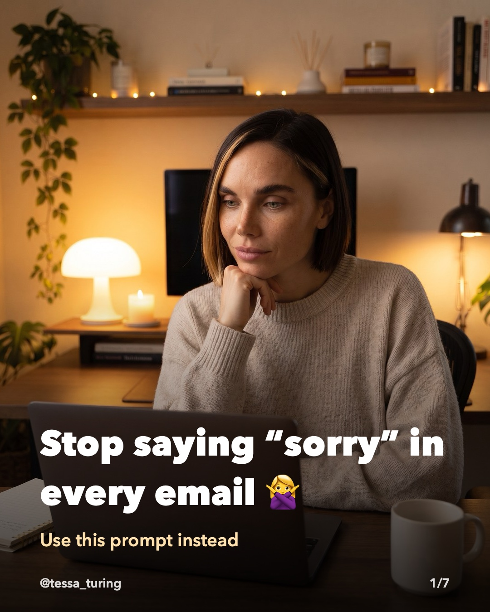
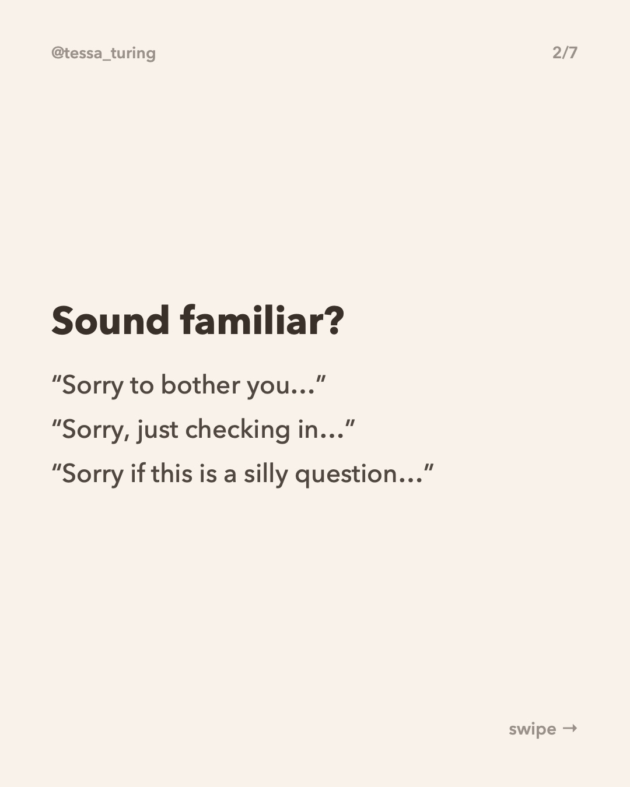
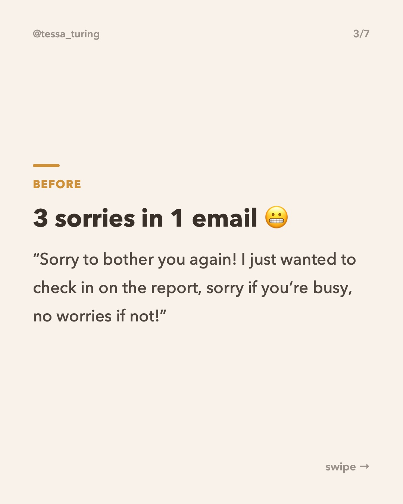
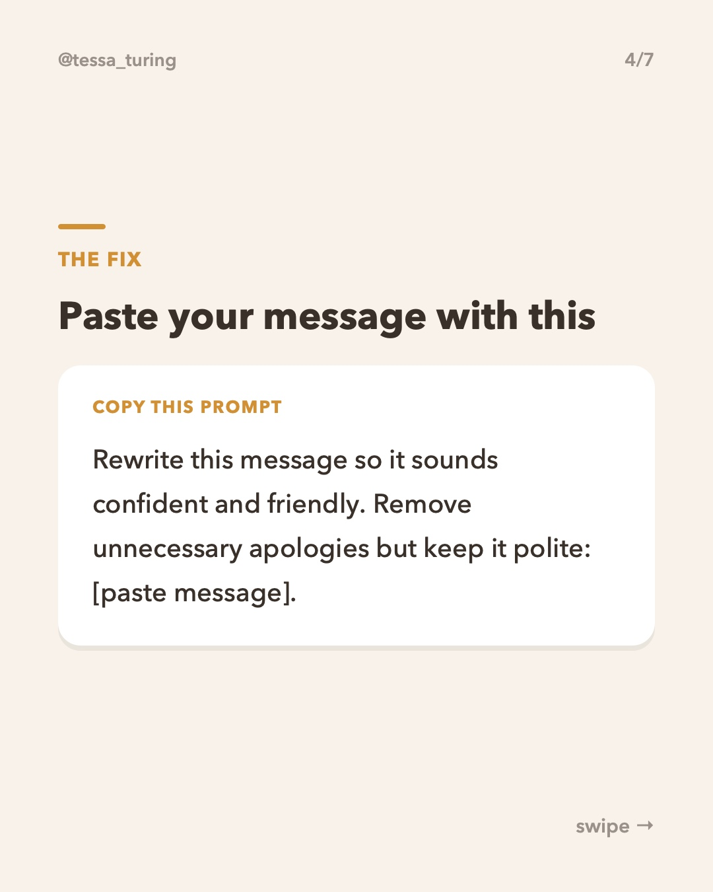
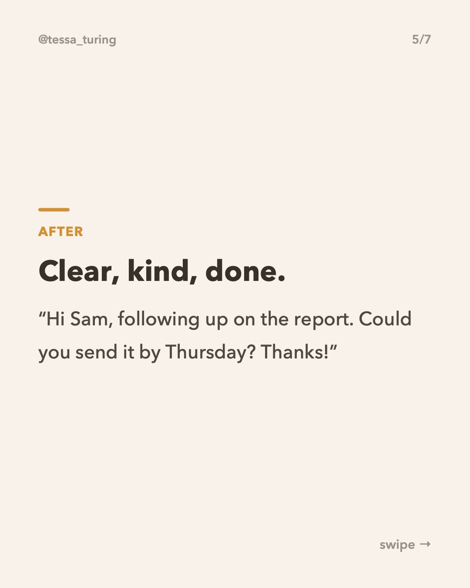
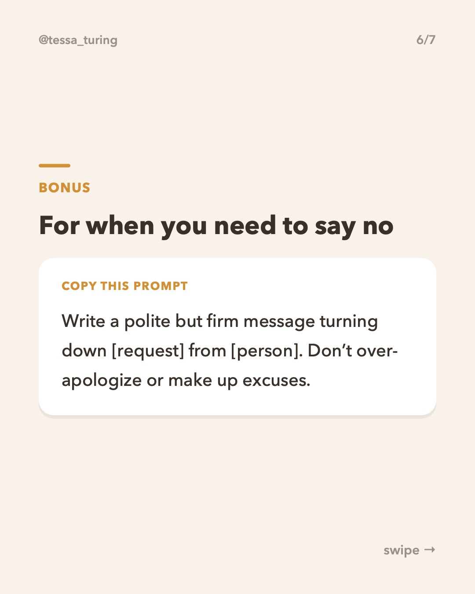
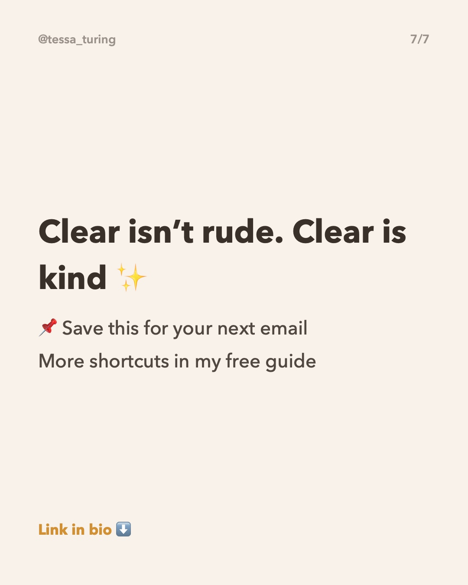

**Scheduled to post later today (2 hours after the previous post).**

To skip it, just **close this issue**. Do nothing and it posts automatically.

**Topic:** Stop saying sorry in emails: confident rewrite prompt









**Caption:**

```
You don't need to apologize for sending an email 🙅‍♀️

Paste your message into ChatGPT, Claude or Gemini with the prompt on slide 4. You'll get a version that's polite, clear and confident.

Which one are you guilty of: "sorry to bother you" or "just checking in"? 👇

⬇️ More shortcuts in my free guide (link in bio)

#aitips #chatgptprompts #emailtips #careertips #worksmarter
```
