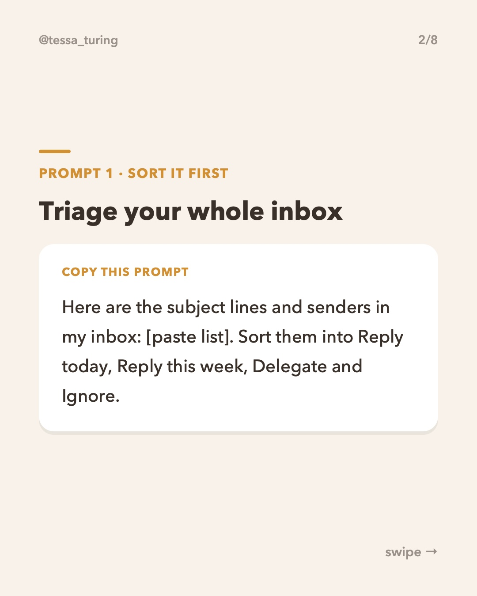
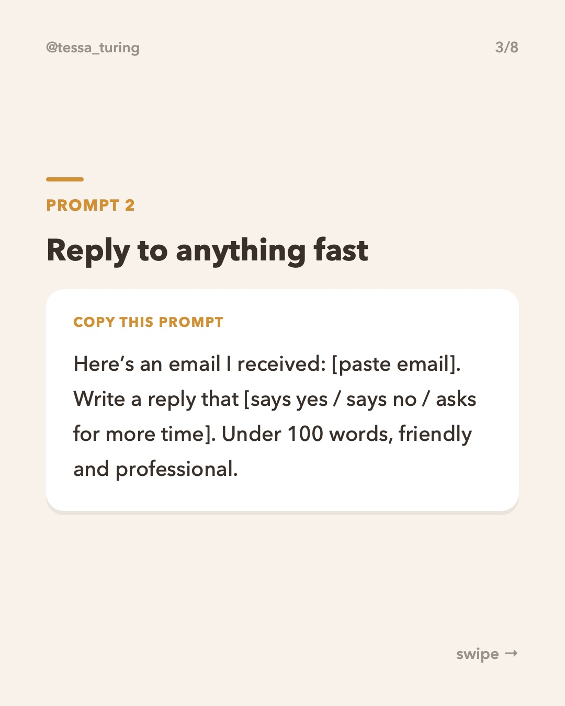
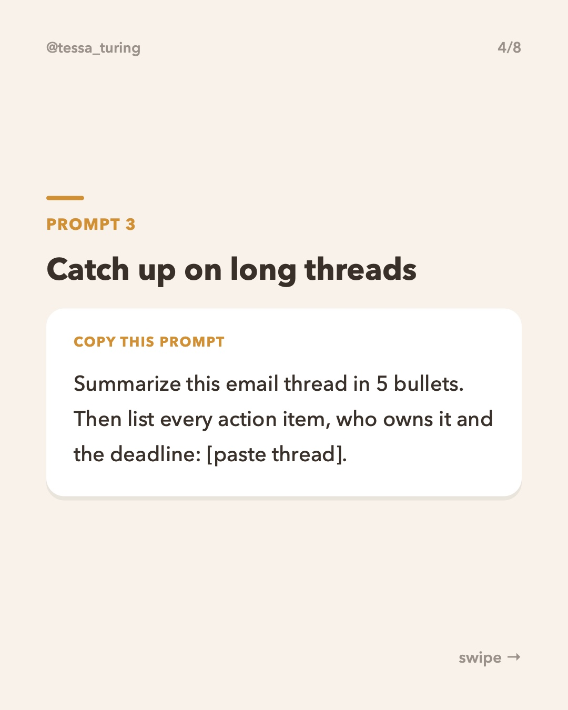
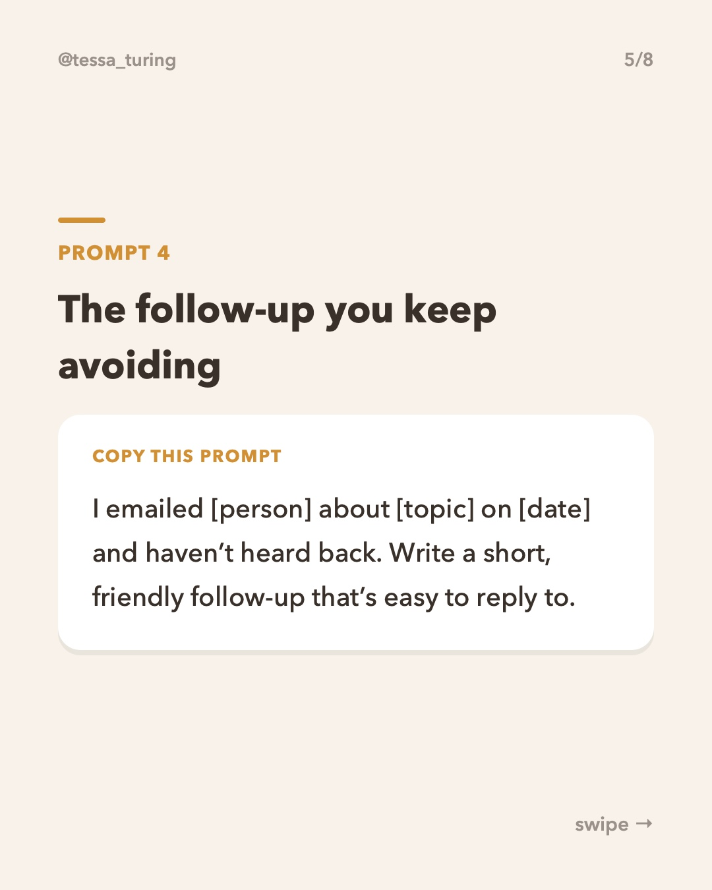
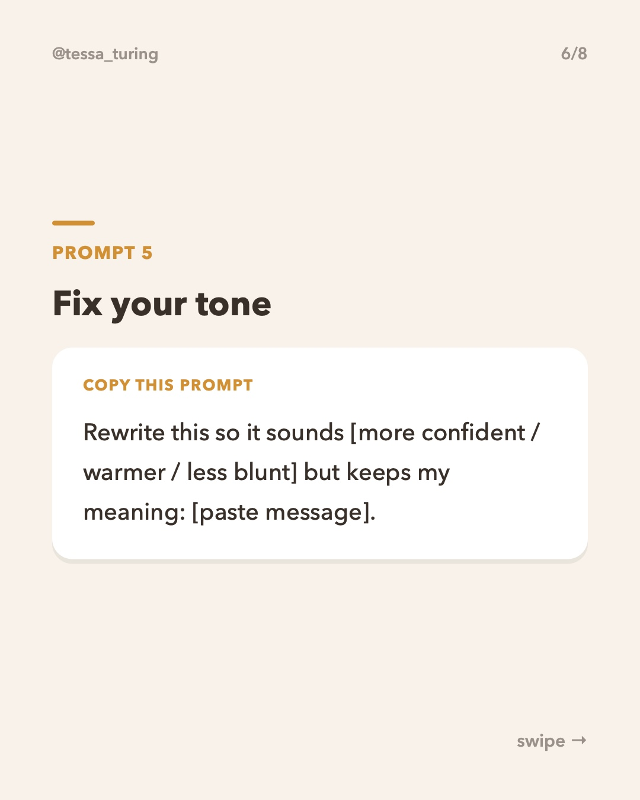
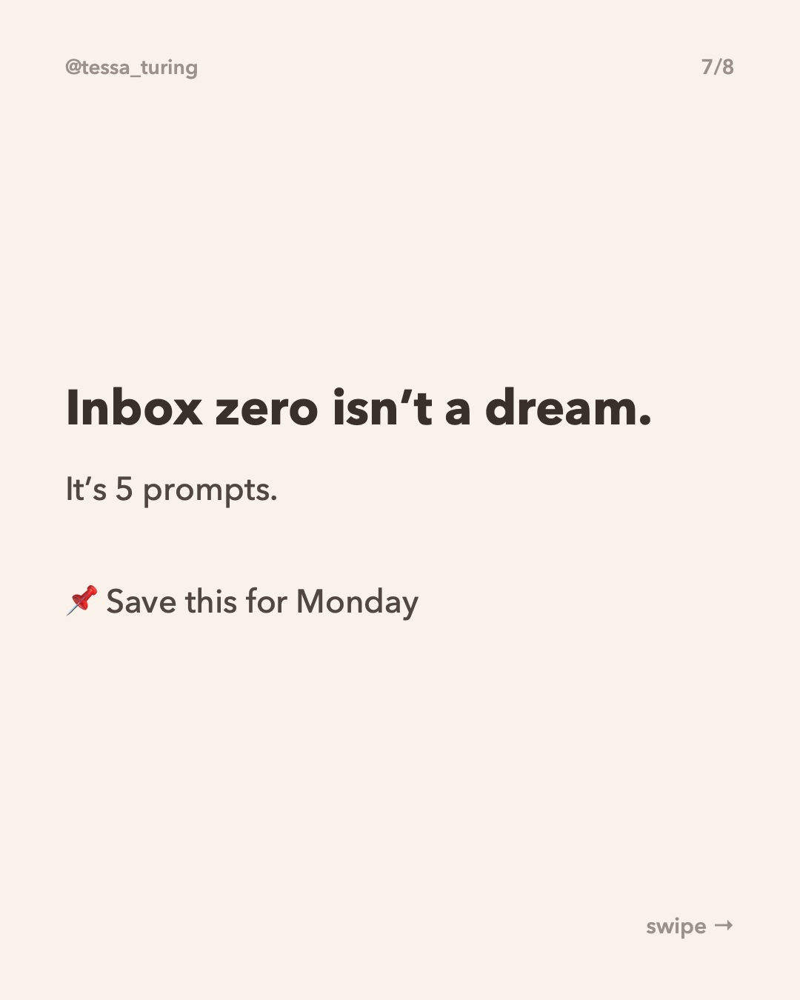
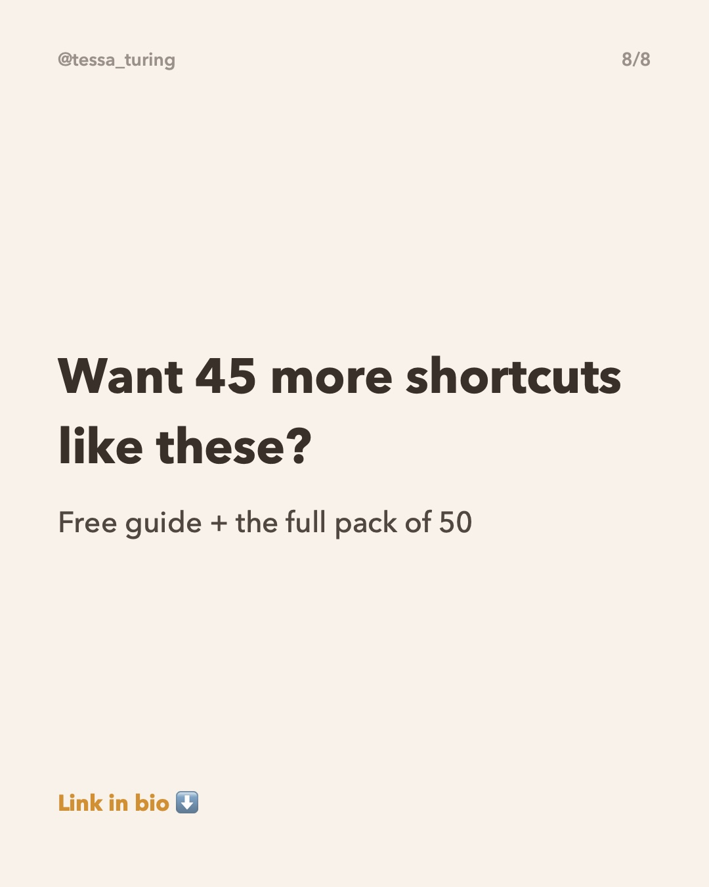

**Scheduled to post later today (2 hours after the previous post).**

To skip it, just **close this issue**. Do nothing and it posts automatically.

**Topic:** 5 prompts that clear your inbox in 10 minutes










**Caption:**

```
Your inbox doesn't need more willpower. It needs better prompts 📥

Paste these into ChatGPT, Claude or Gemini and fill in the [brackets]. Start with #1 to sort everything, then work down the list.

📌 Save this for your next inbox day
⬇️ Free guide with 10 more shortcuts in my bio

#aitips #chatgptprompts #emailtips #productivityhacks #inboxzero
```
