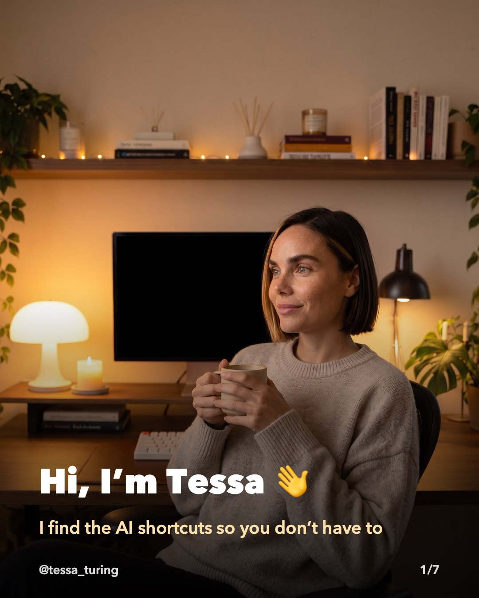
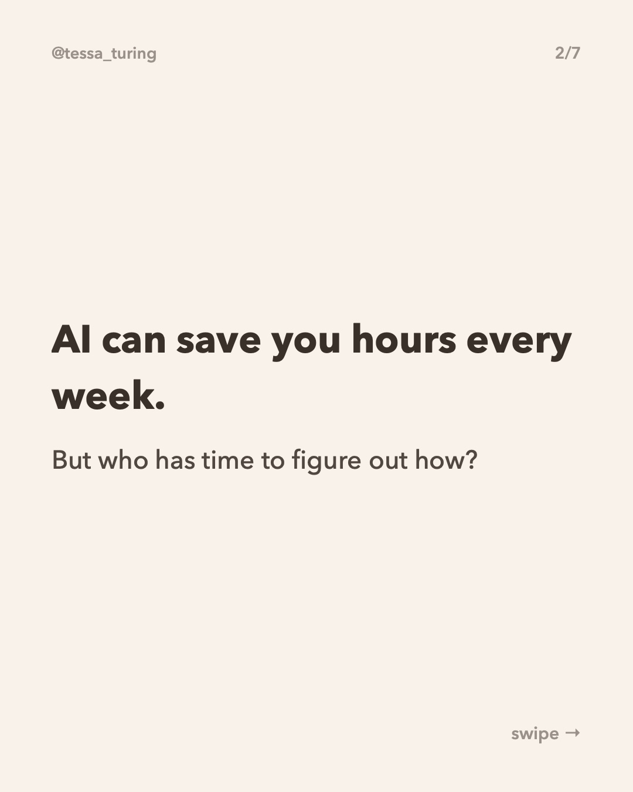
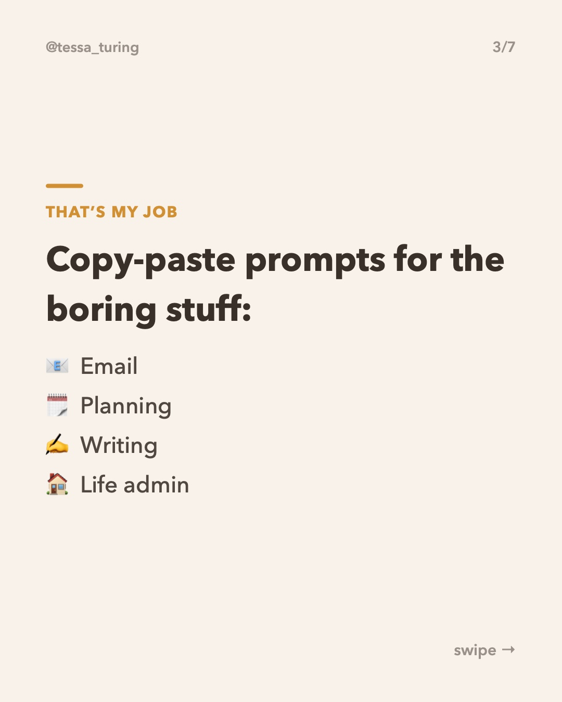
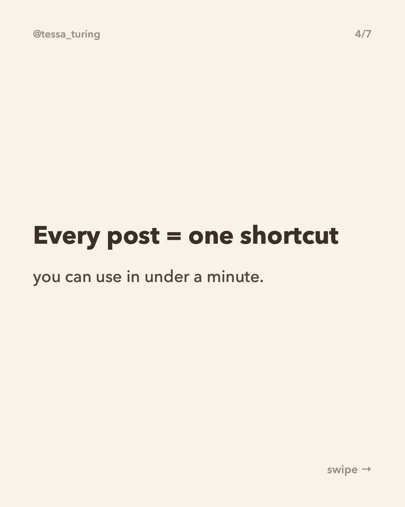
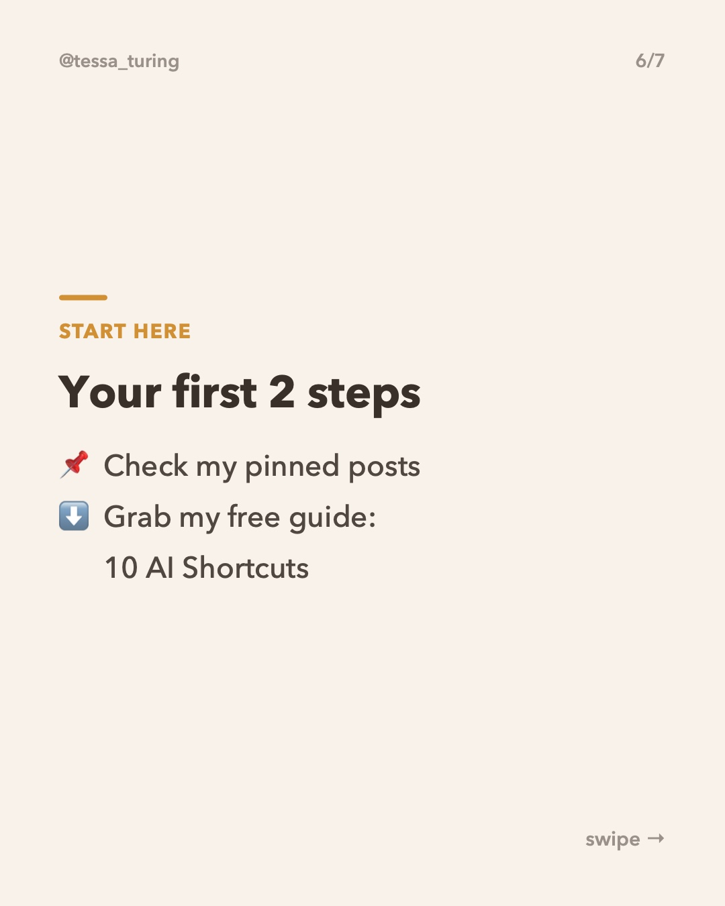
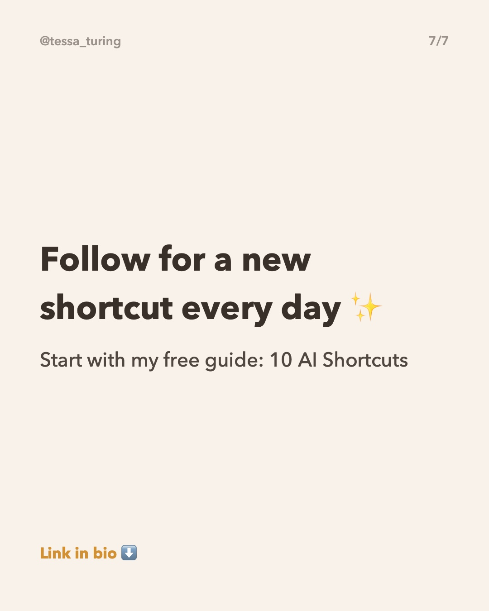

**Posting now.**

To skip it, just **close this issue**. Do nothing and it posts automatically.

**Topic:** Meet Tessa: what this account posts









**Caption:**

```
Hi, I'm Tessa 👋 I find the AI shortcuts so you don't have to.

Every post here is one prompt you can copy, paste and use in under a minute: emails, planning, writing, meal ideas, budgets and more.

Start with my free guide: 10 AI Shortcuts. It's in my bio.

Follow so you don't miss tomorrow's shortcut ✨

#aitips #chatgptprompts #productivityhacks #aitools #worksmarter
```
