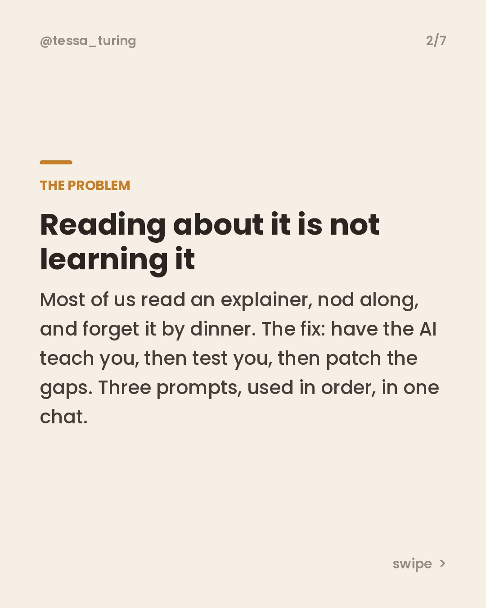
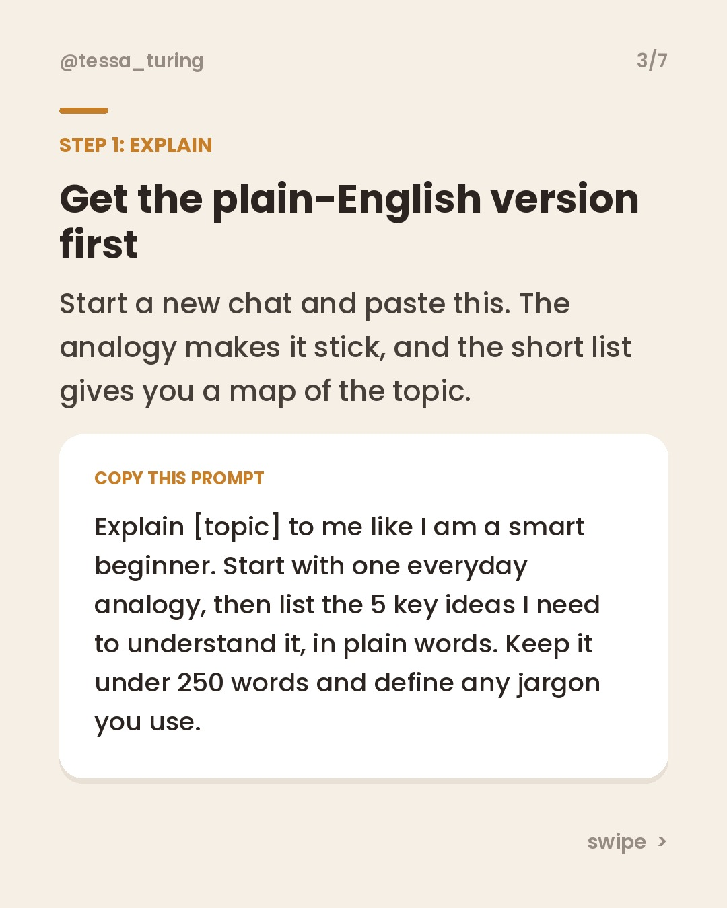
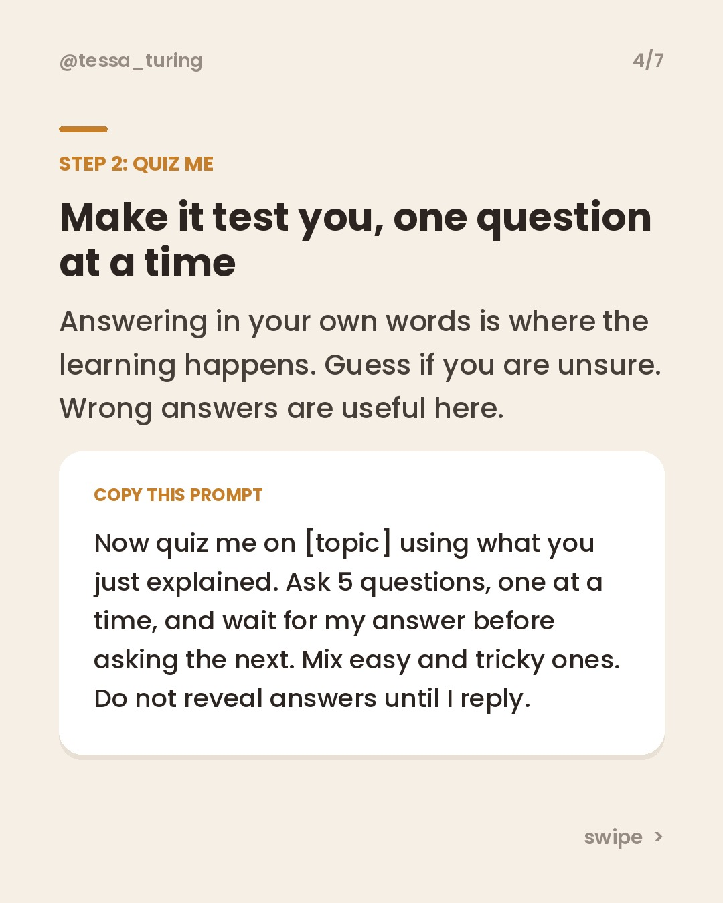
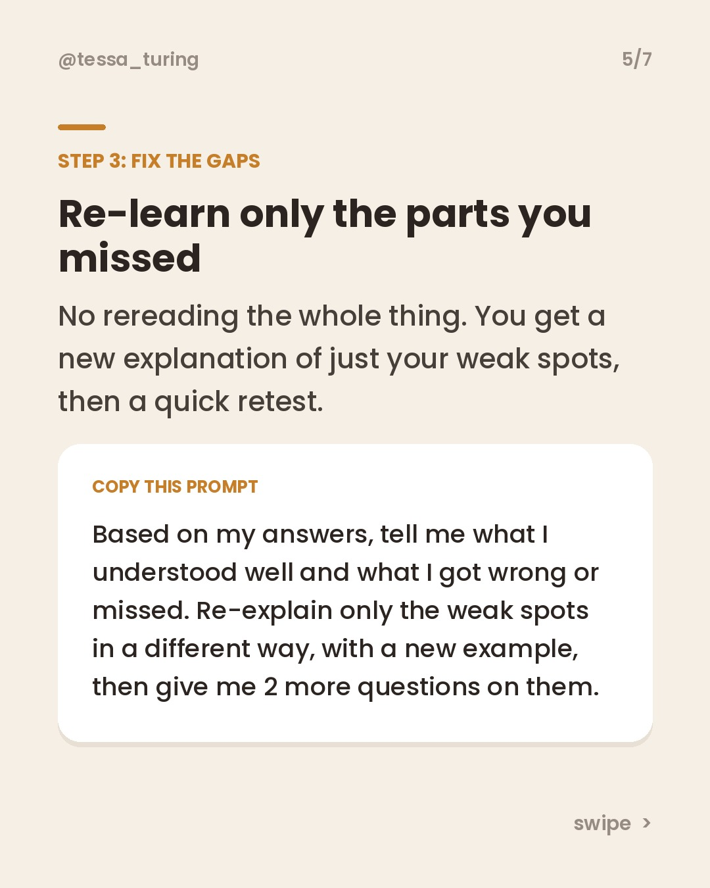
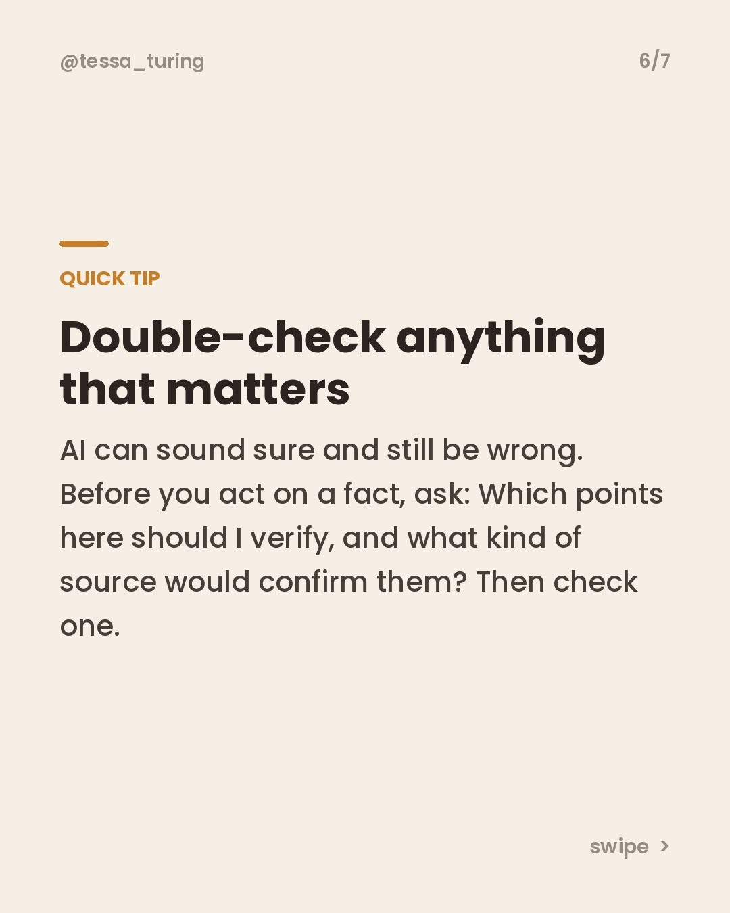

**Scheduled to post Friday, November 13 at 8 AM Eastern.**

To skip it, just **close this issue**. Do nothing and it posts automatically.

**Topic:** A 3-prompt study loop to learn any topic: explain, quiz, fix the gaps









**Caption:**

```
Reading about something is not the same as learning it. 📚

This 3-prompt loop turns any free AI chat into a patient tutor.
Step 1: get a plain-English explanation with an analogy.
Step 2: have it quiz you, one question at a time.
Step 3: re-learn only the bits you missed.

Save this for the next topic you keep meaning to understand. 🔖

More shortcuts in my free guide, 10 AI Shortcuts. Link in bio.

#aiprompts #learnsomethingnew #studytips #chatgpttips #productivityhacks
```
