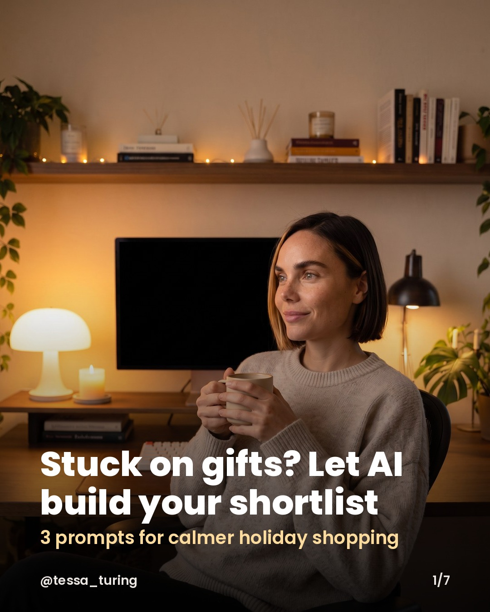
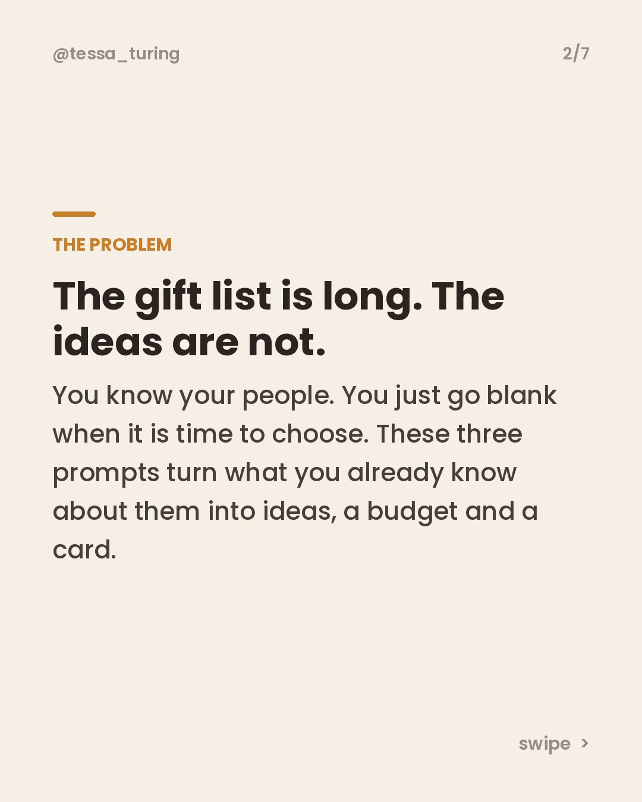
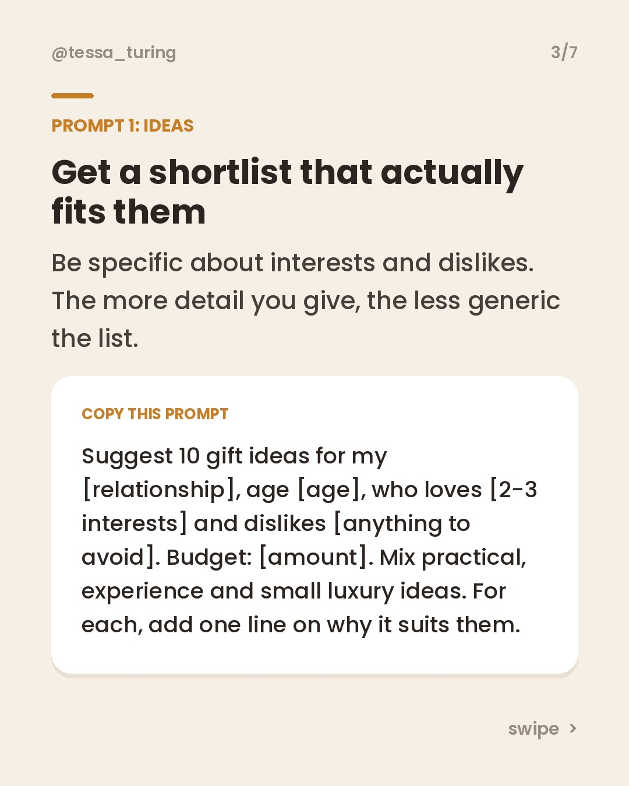
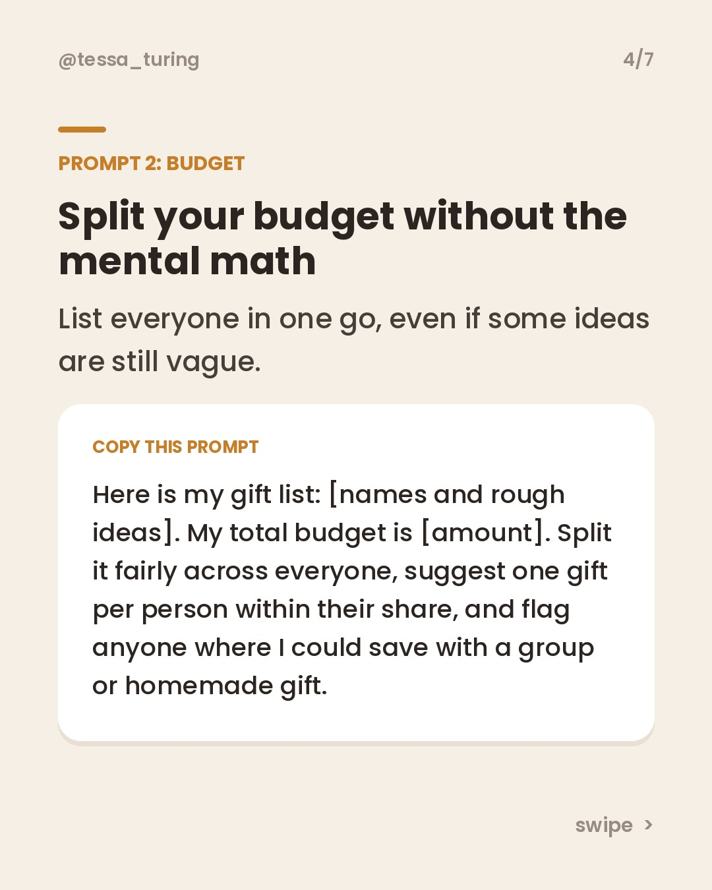
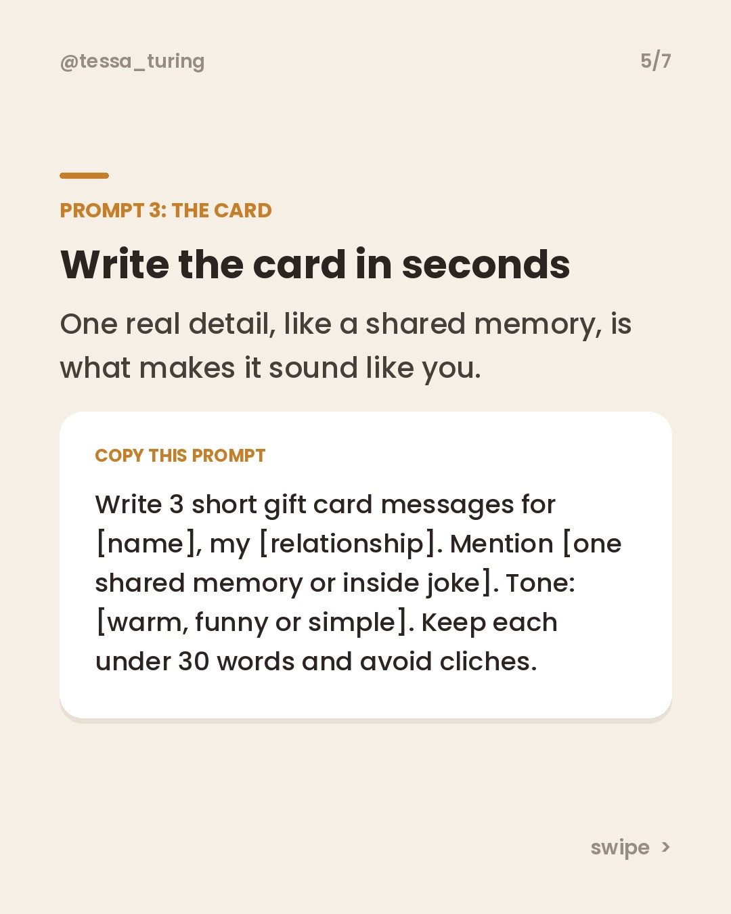
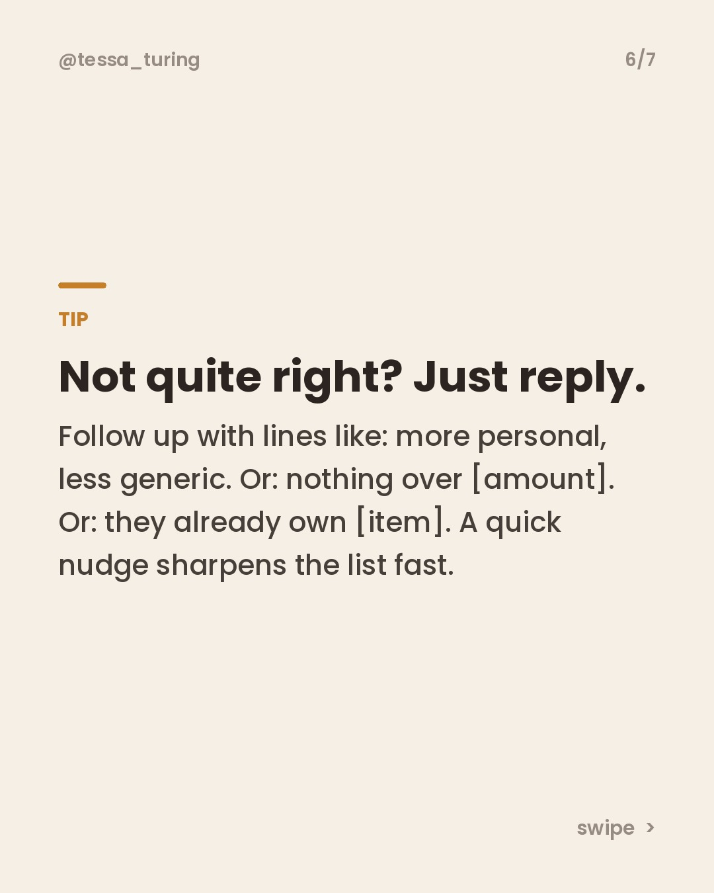
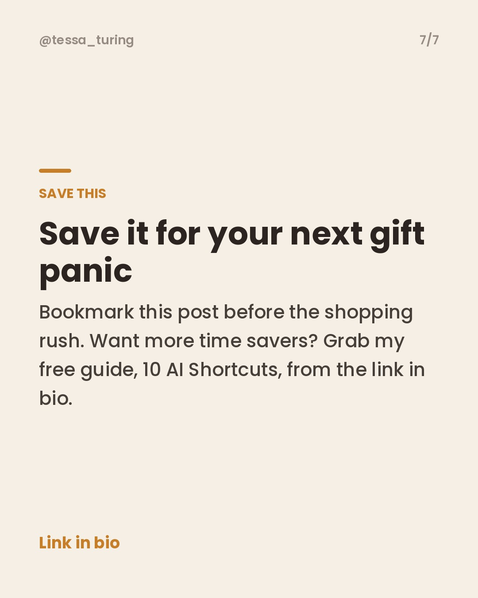

**Scheduled to post Saturday, November 14 at 8 AM Eastern.**

To skip it, just **close this issue**. Do nothing and it posts automatically.

**Topic:** Holiday gift planning with AI: idea shortlist, budget split and card messages









**Caption:**

```
Gift season is coming and your brain is already blank. 🎁

These 3 prompts do the heavy lifting:
1. A shortlist of ideas that fit the person, not just the price.
2. A fair budget split across your whole list.
3. Card messages that sound like you wrote them.

Save this so it is ready when the shopping rush hits. 📌

Want more shortcuts like this? My free guide, 10 AI Shortcuts, is in my bio.

#giftideas #holidayplanning #chatgpttips #aishortcuts #christmasshopping
```
