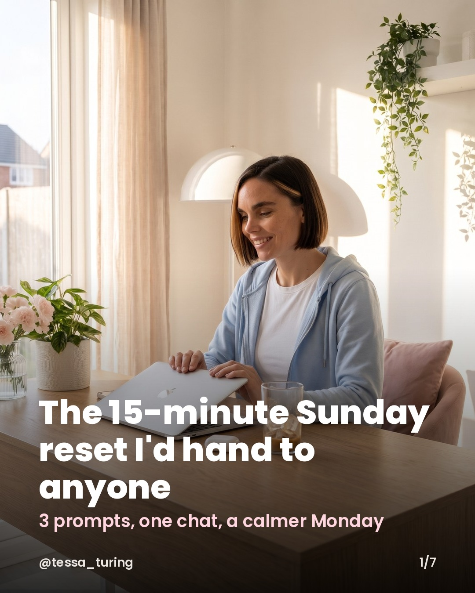
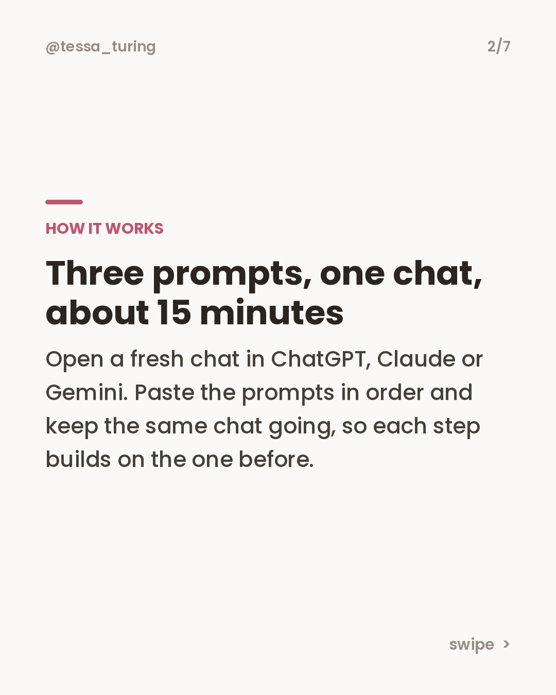
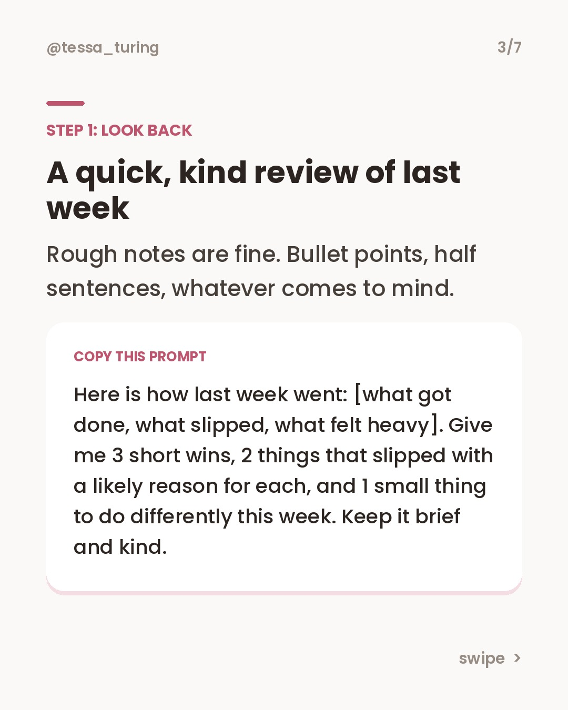
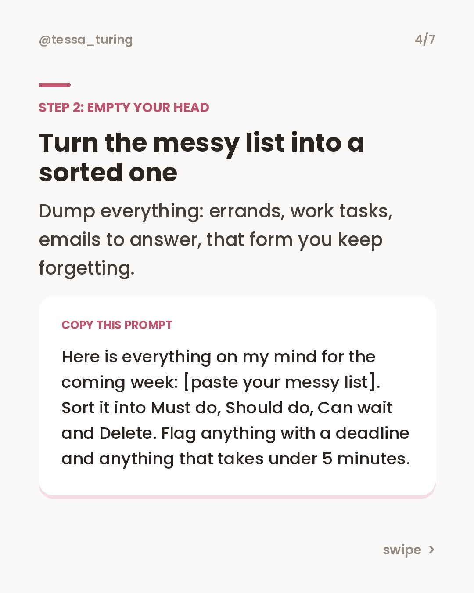
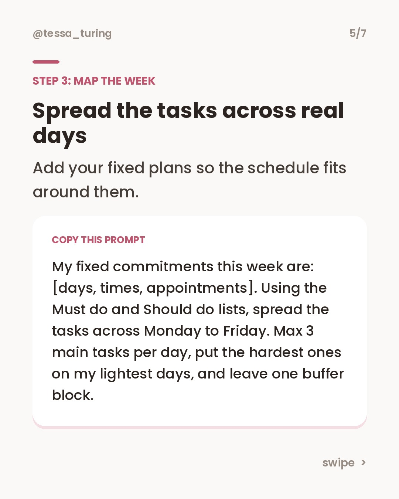
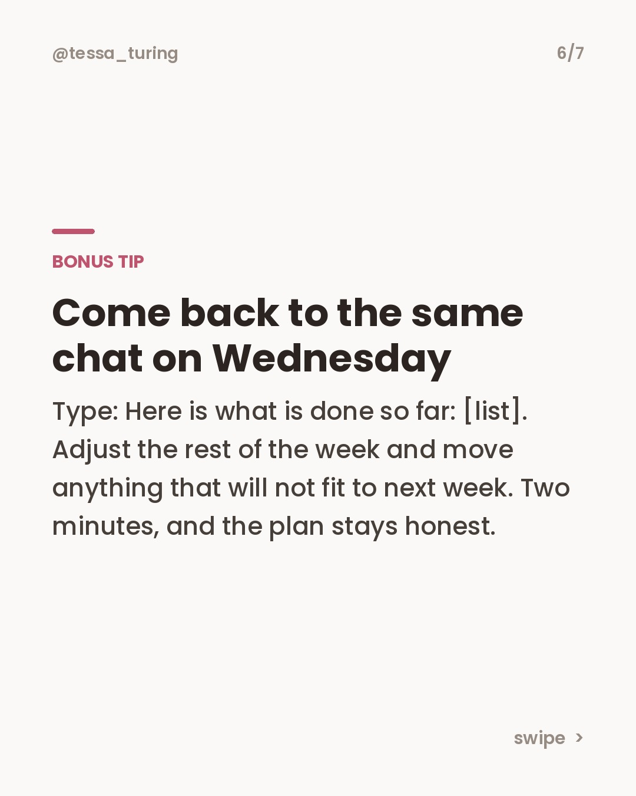

**Scheduled to post Sunday, November 15 at 8 AM Eastern.**

To skip it, just **close this issue**. Do nothing and it posts automatically.

**Topic:** Sunday weekly reset in 3 prompts: look back, sort the brain dump, map the week









**Caption:**

```
Sunday reset, done in about 15 minutes ☕

One chat, three prompts, pasted in order.
First a quick look back at last week, then a sort of everything rattling around your head.
The last prompt spreads it across real days, with a cap of 3 main tasks each.
On Wednesday, pop back into the same chat for a two-minute adjustment.

Save this so it's ready next Sunday 📌
My free guide, 10 AI Shortcuts, is in the link in bio.

#sundayreset #weeklyplanning #chatgptprompts #productivitytips #aishortcuts
```
