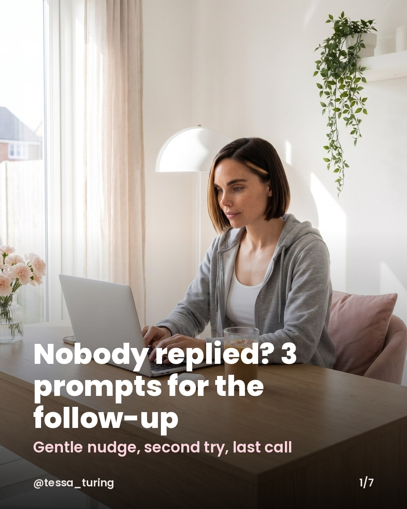
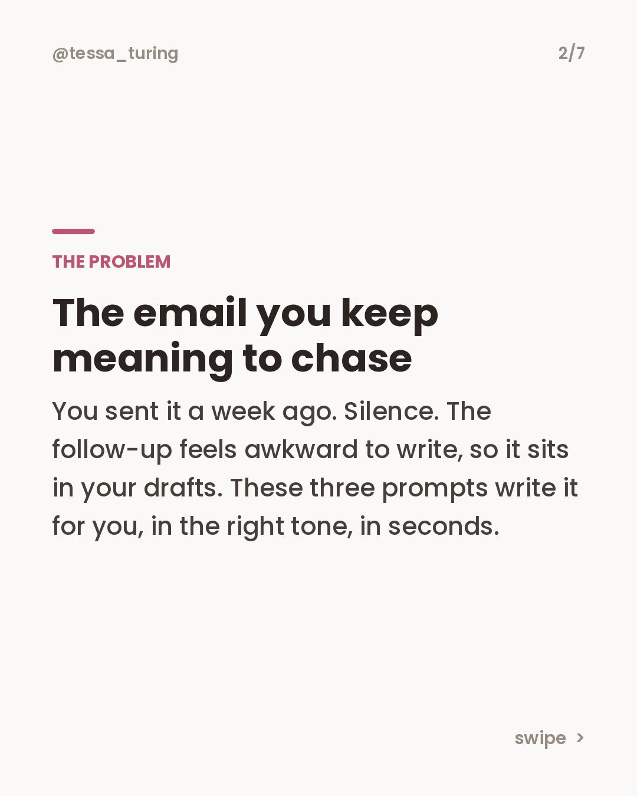
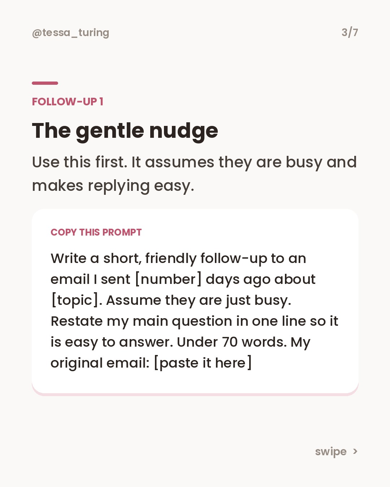
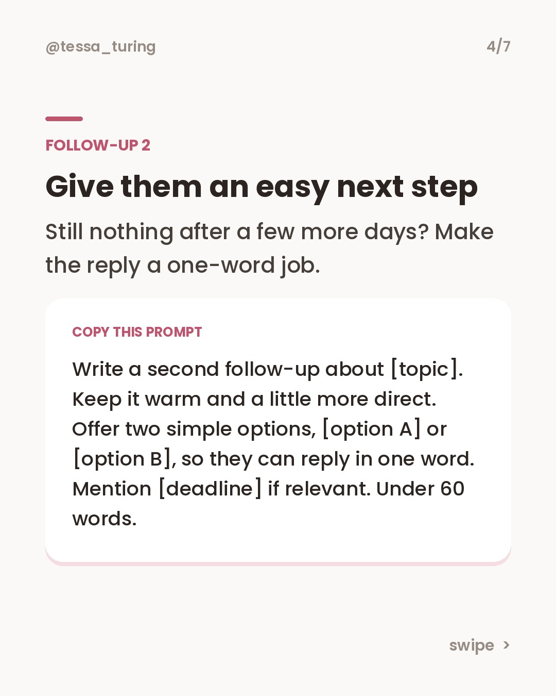
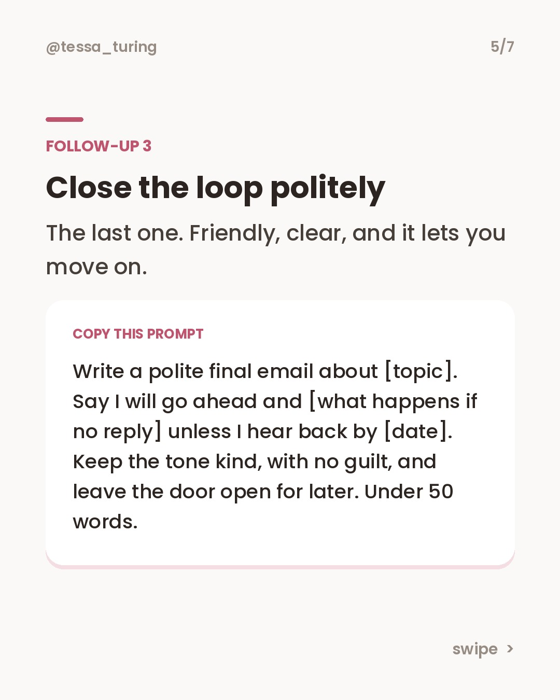
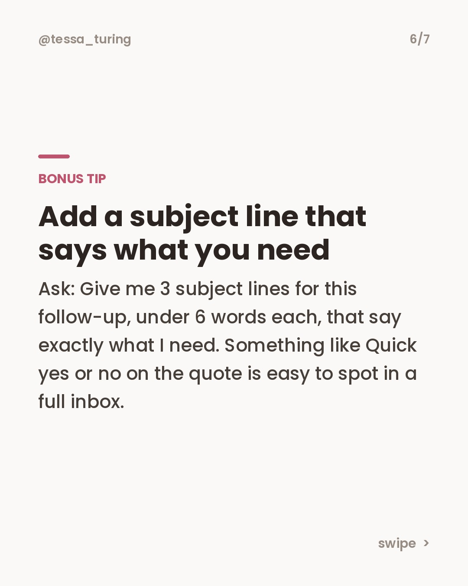
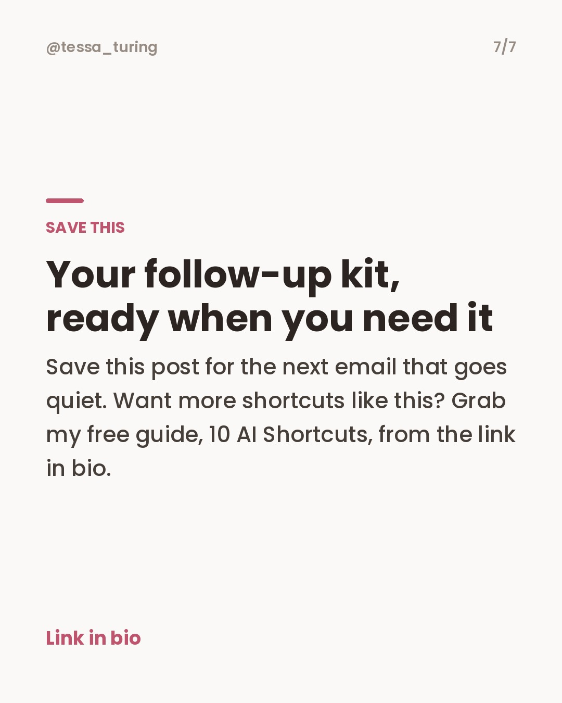

**Scheduled to post Monday, November 16 at 8 AM Eastern.**

To skip it, just **close this issue**. Do nothing and it posts automatically.

**Topic:** Polite follow-up emails when nobody replied: gentle nudge, clear next step, close the loop









**Caption:**

```
That email you sent last week and never heard back on? Let's deal with it 📬

Three prompts, three follow-ups: a gentle nudge, a clear next step, and a polite last call.
Paste in your original email, fill in the brackets, and you have a reply-ready message in under a minute.
Works in the free versions of ChatGPT, Claude or Gemini.

Save this for the next time someone goes quiet 🔖
More shortcuts in my free guide, 10 AI Shortcuts, link in bio.

#emailtips #chatgptprompts #productivityhacks #aishortcuts #worksmarter
```
