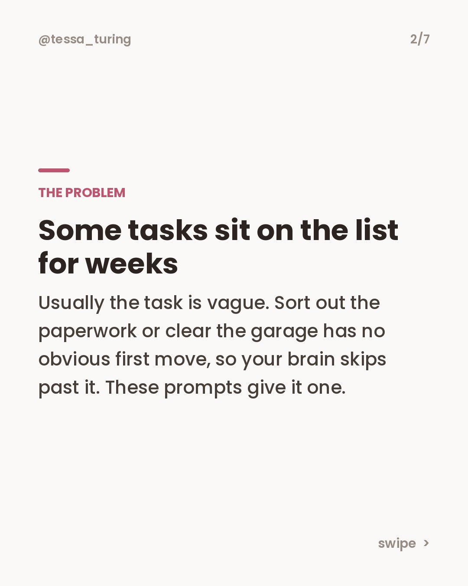
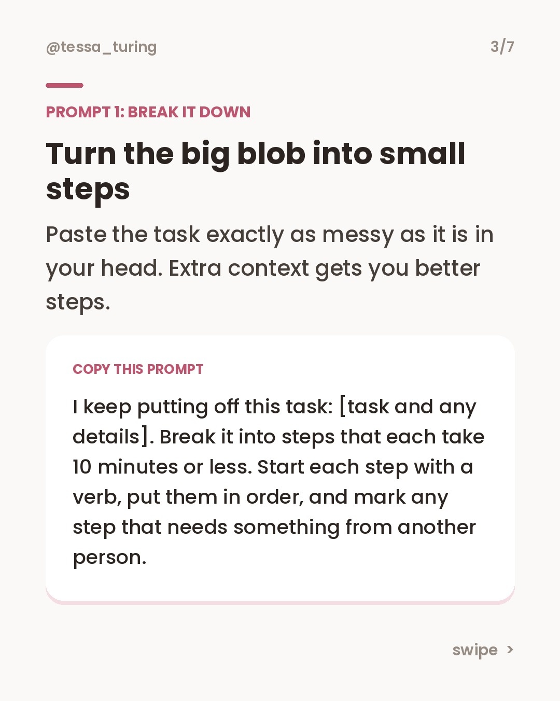
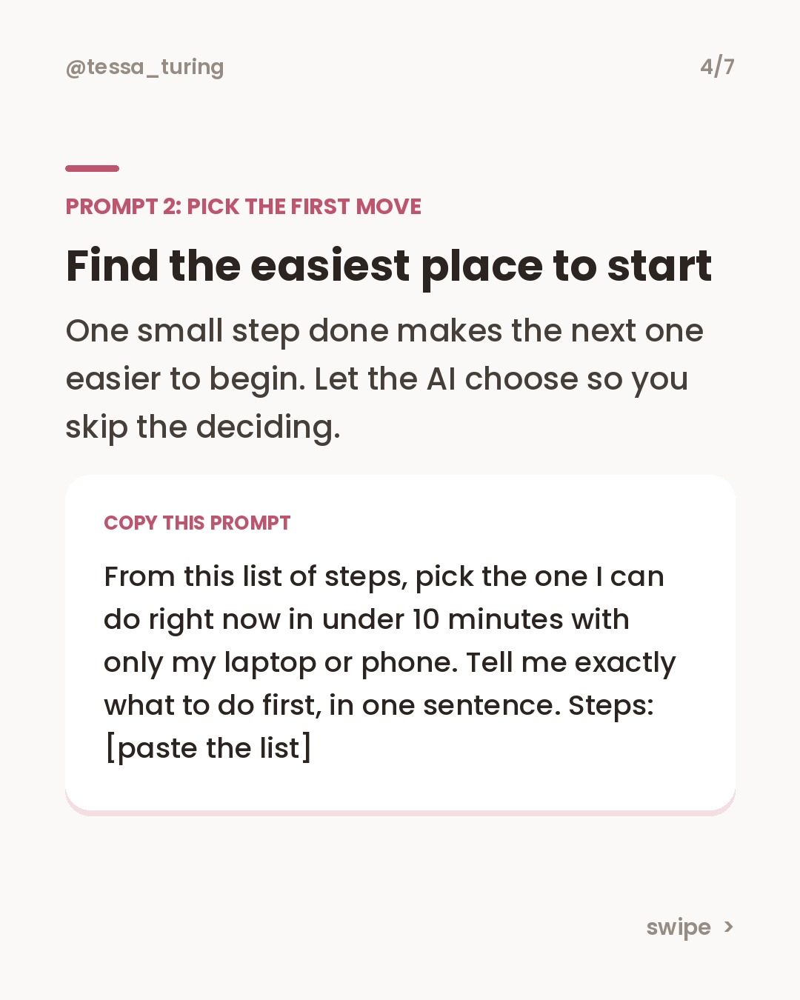
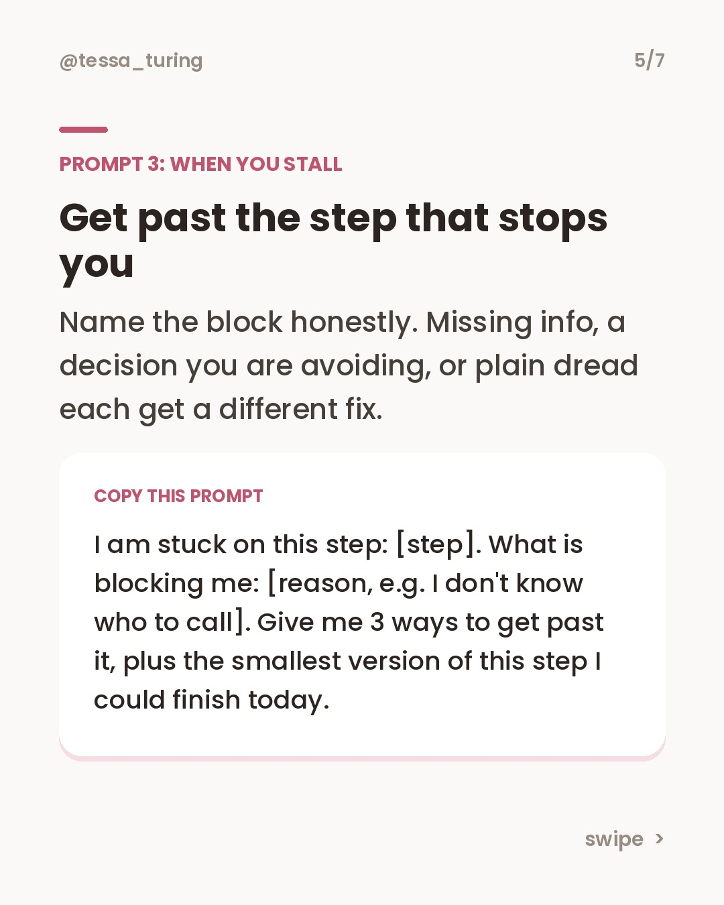
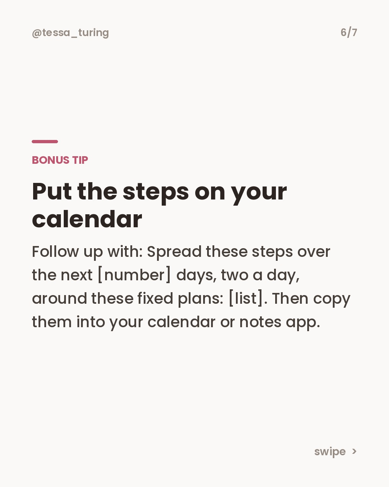
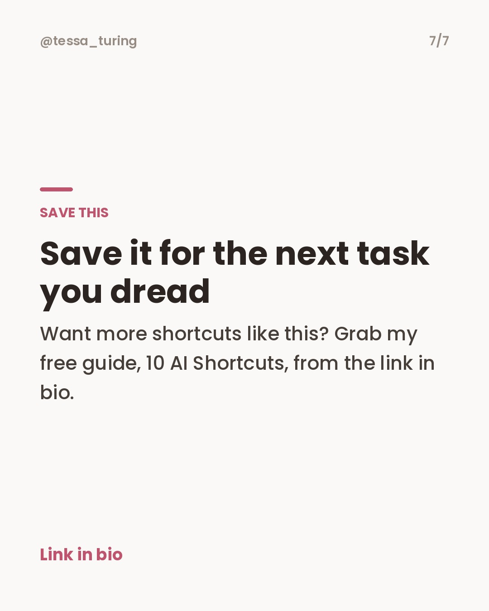

**Scheduled to post Tuesday, November 17 at 8 AM Eastern.**

To skip it, just **close this issue**. Do nothing and it posts automatically.

**Topic:** Breaking a dreaded, put-off task into 10-minute steps with three prompts: break it down, pick the first move, and get unstuck









**Caption:**

```
That one task that has been on your list since September? Let's move it. 📋

Big vague tasks are hard to start because there's no clear first step.
Prompt 1 breaks it into 10-minute pieces.
Prompt 2 picks the easiest one to do right now.
Prompt 3 helps when a step stalls you out.

Save this for the next time a to-do just sits there. 📌
More shortcuts like these are in my free guide, 10 AI Shortcuts, at the link in bio.

#productivitytips #procrastination #chatgptprompts #aishortcuts #todolist
```
