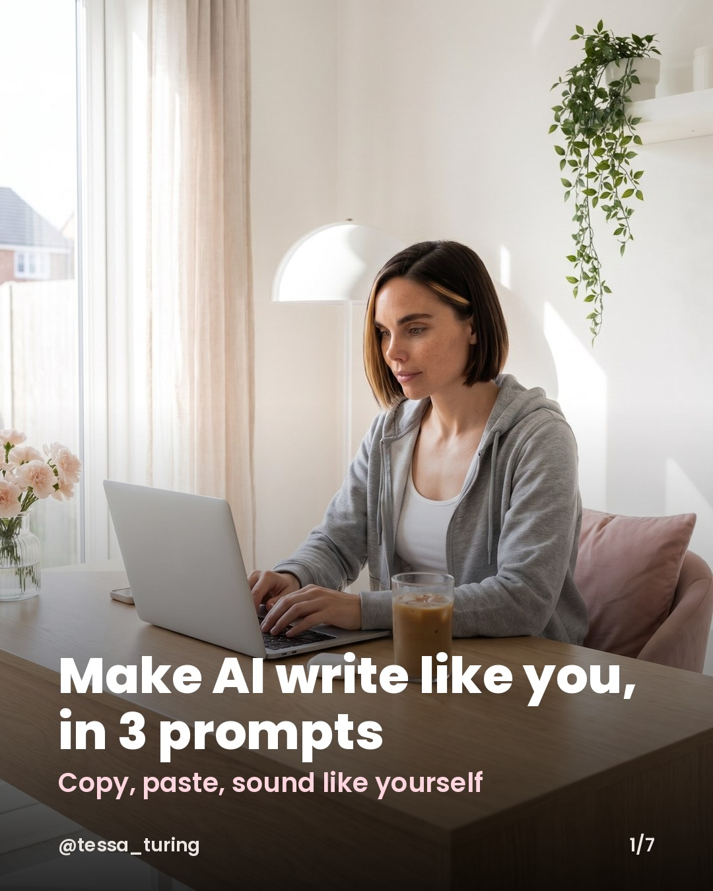
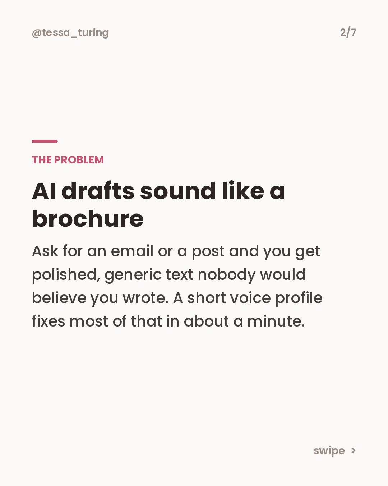
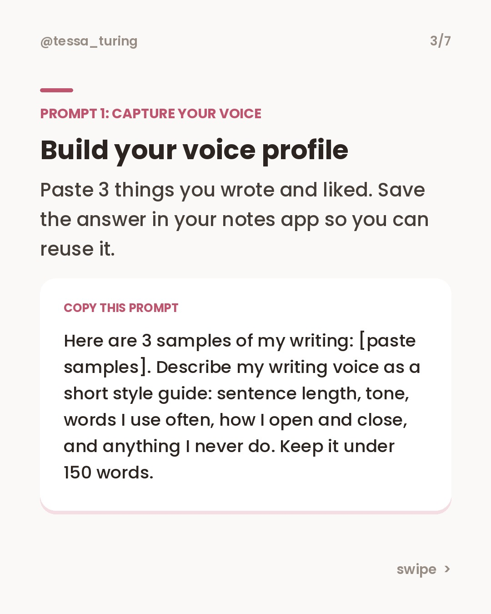
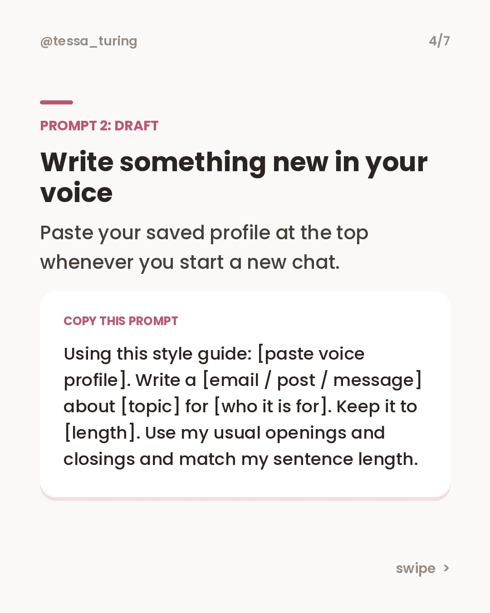
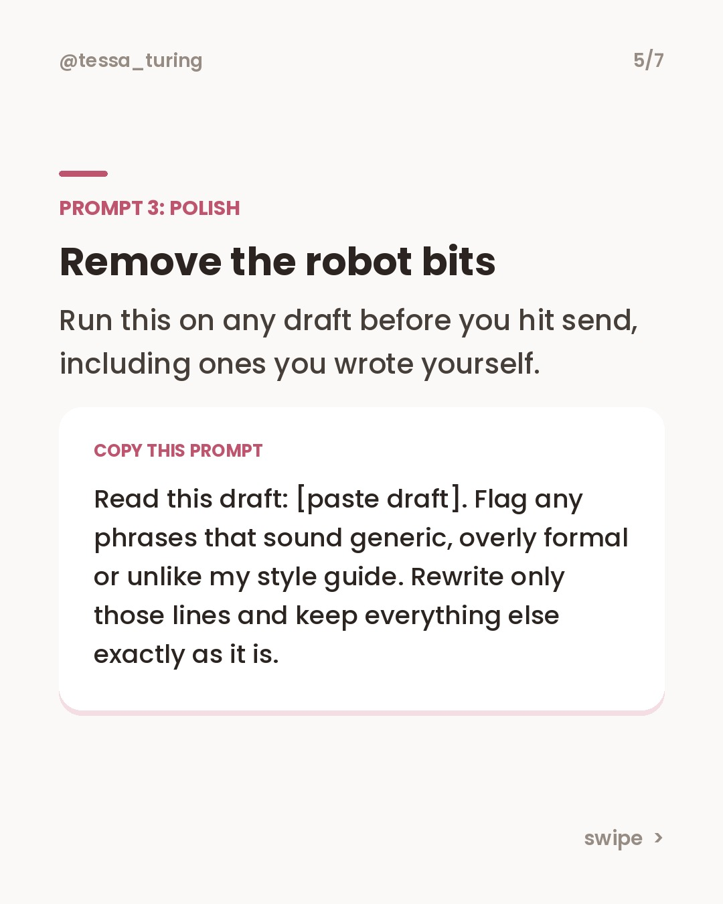
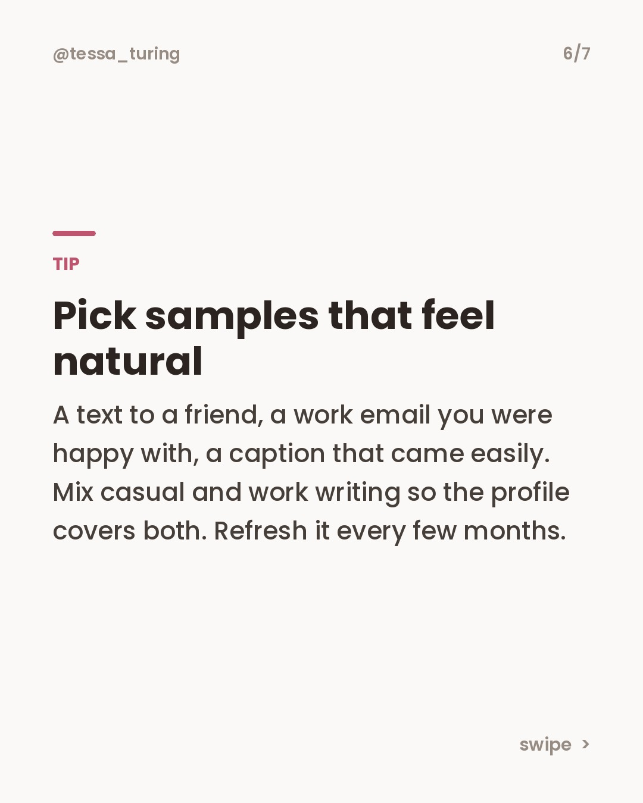
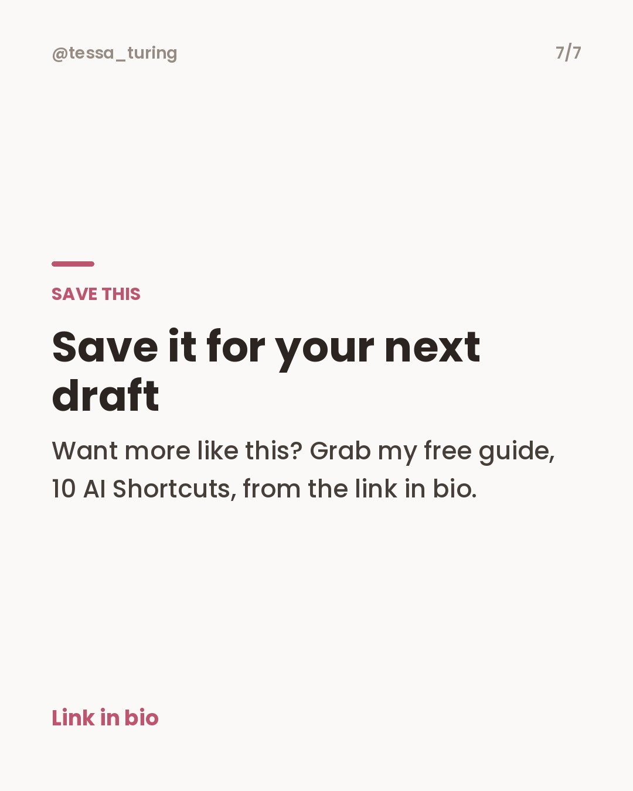

**Scheduled to post Wednesday, November 18 at 8 AM Eastern.**

To skip it, just **close this issue**. Do nothing and it posts automatically.

**Topic:** Teach AI your writing voice so drafts sound like you: capture your voice, draft with it, polish out the generic bits









**Caption:**

```
Does your AI draft sound like a corporate brochure? 📝

Three prompts make it sound like you.
1. Paste a few things you wrote and get a short style guide of your voice.
2. Use that guide every time you ask for a new email, post or message.
3. Run a final check that rewrites only the lines that sound generic.

Save this so your voice profile is one tap away 📌
My free guide, 10 AI Shortcuts, is in my bio.

#aiprompts #writingtips #chatgpttips #productivityhacks #aishortcuts
```
