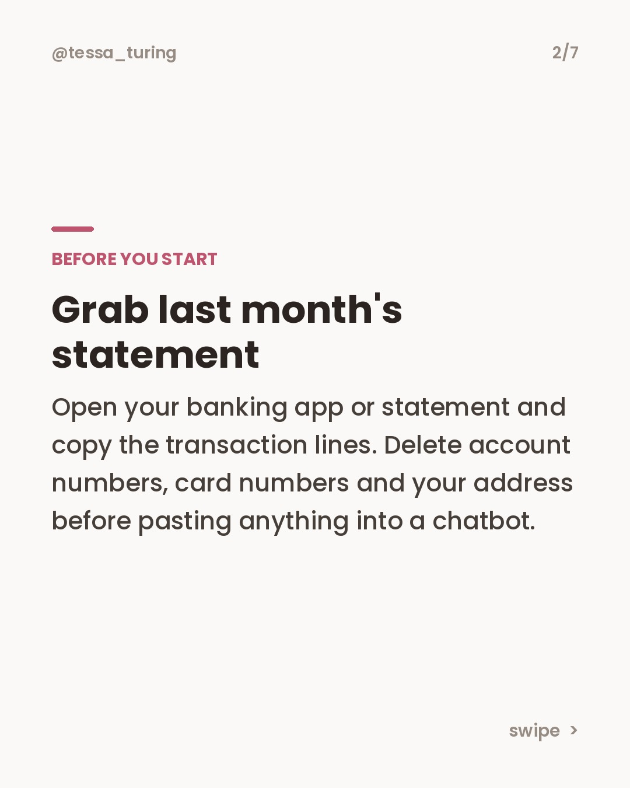
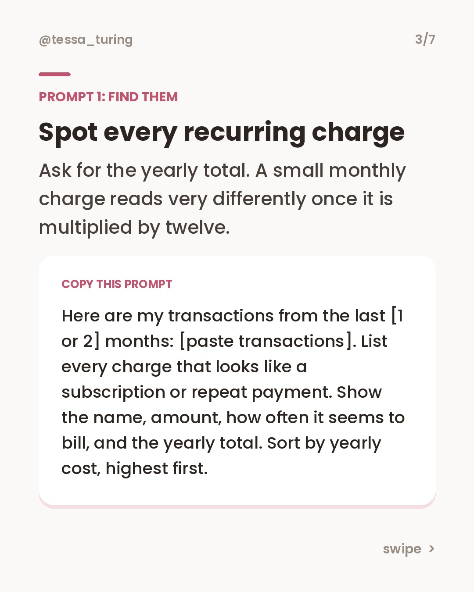
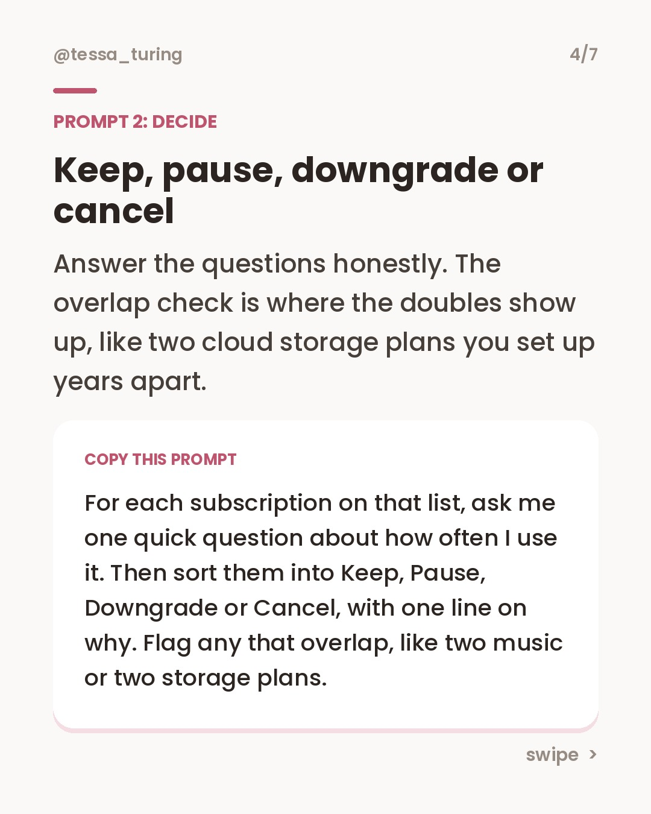
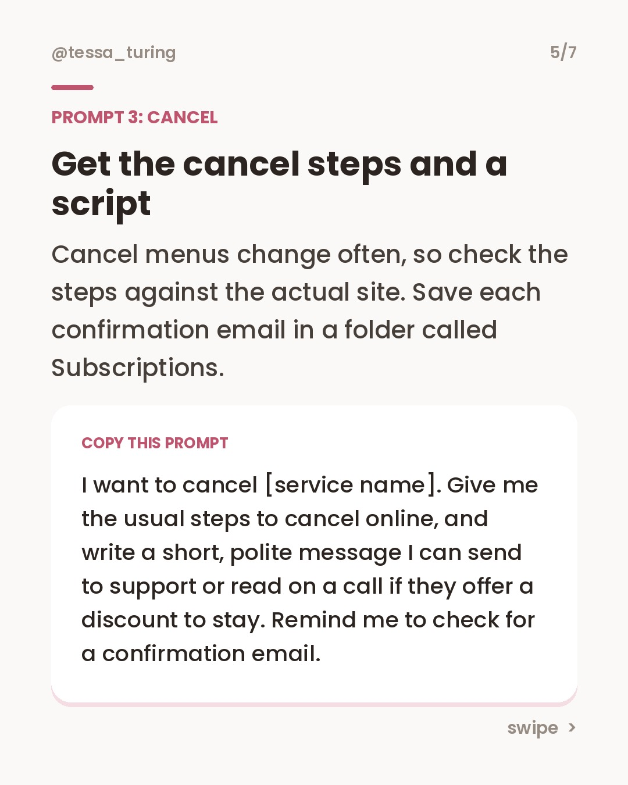
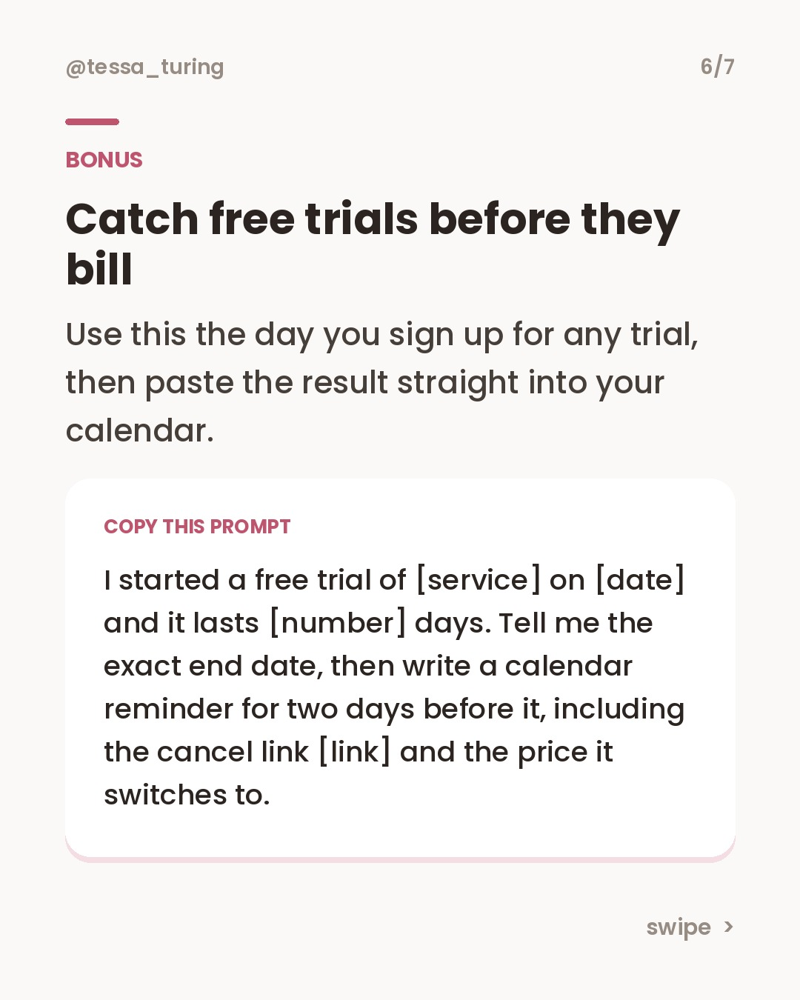

**Scheduled to post Thursday, November 19 at 8 AM Eastern.**

To skip it, just **close this issue**. Do nothing and it posts automatically.

**Topic:** Subscription audit in 3 prompts: find recurring charges, decide what to keep, and get cancel steps plus a script









**Caption:**

```
That small monthly charge you forgot about? It has friends. 🧾

Copy last month's transactions, remove your account and card numbers, and paste them into ChatGPT, Claude or Gemini.
Prompt 1 lists every repeat charge with a yearly total.
Prompt 2 helps you sort keep, pause, downgrade or cancel.
Prompt 3 gives you the cancel steps and a polite script for the retention offer.

Save this for the next time your statement lands. 📌
My free guide, 10 AI Shortcuts, is waiting for you at the link in bio.

#lifeadmin #subscriptions #budgetingtips #chatgptprompts #aishortcuts
```
