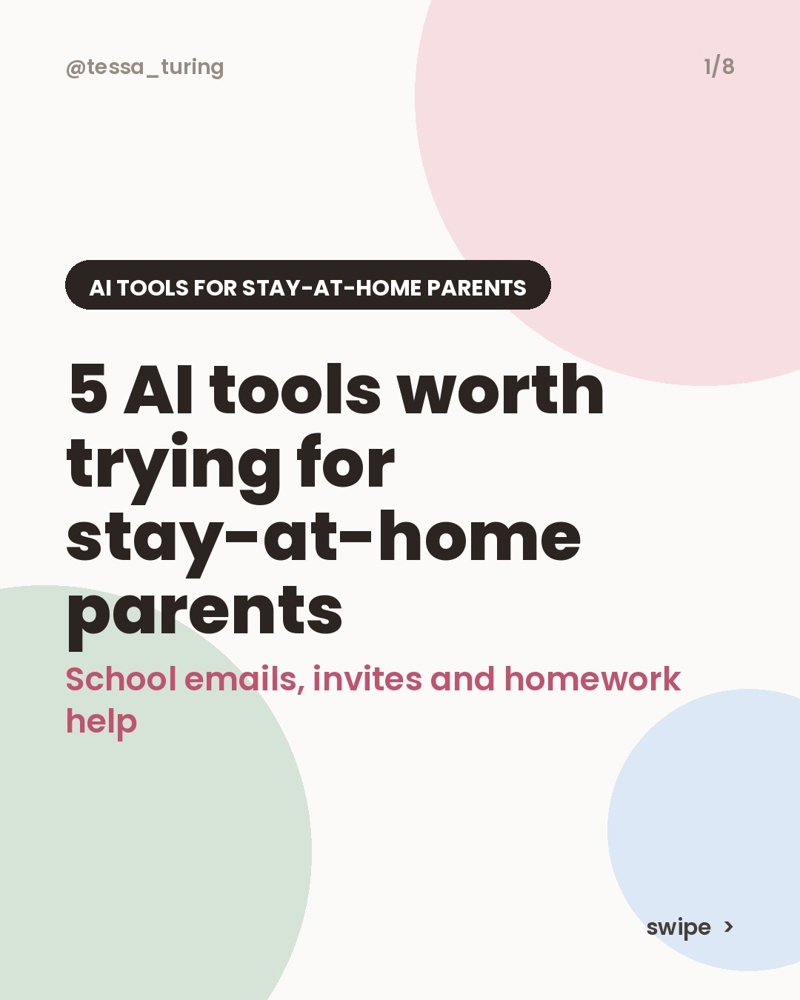
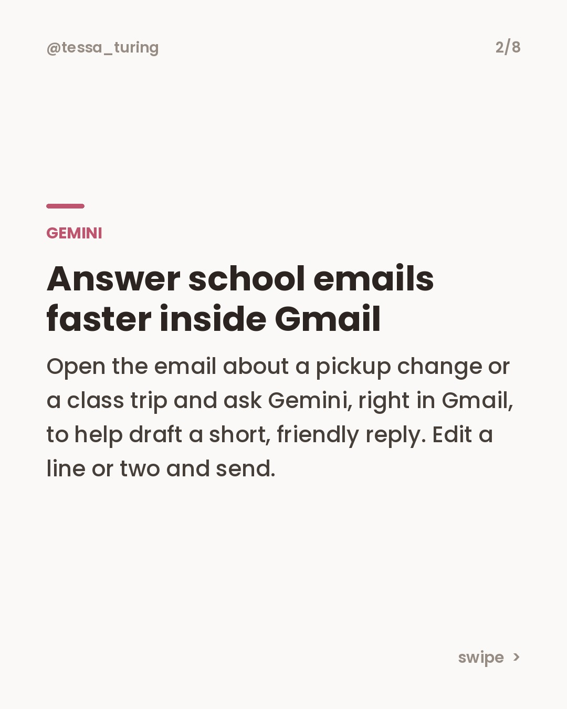
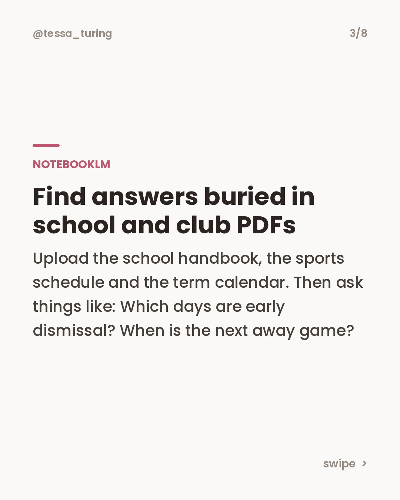
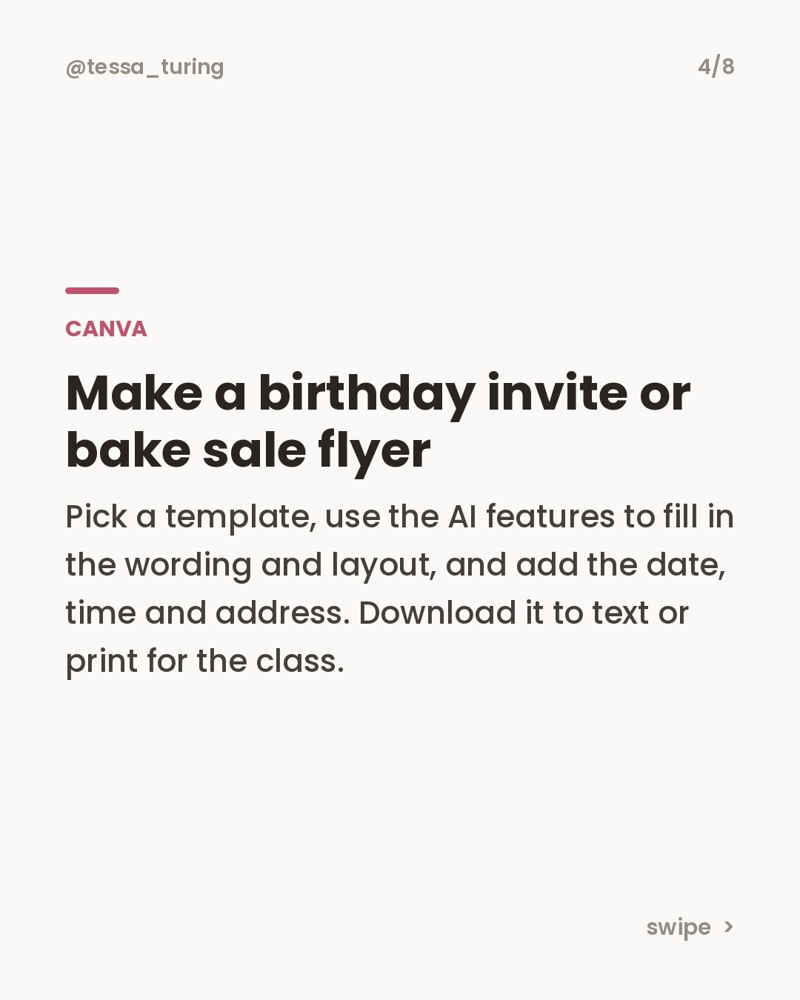
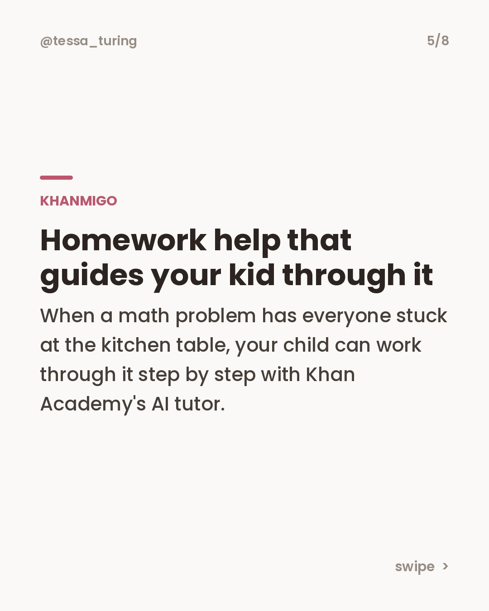
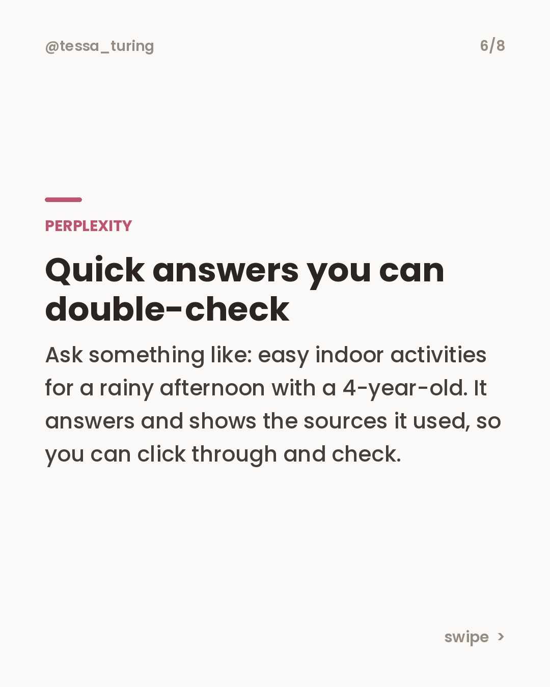
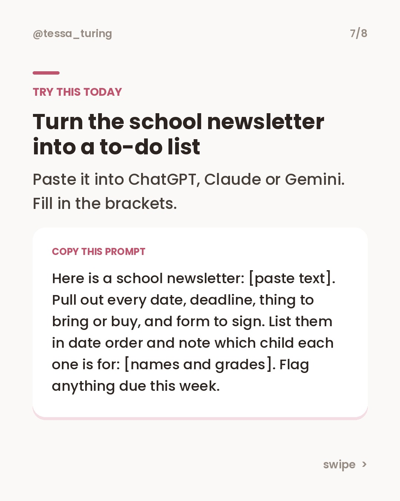
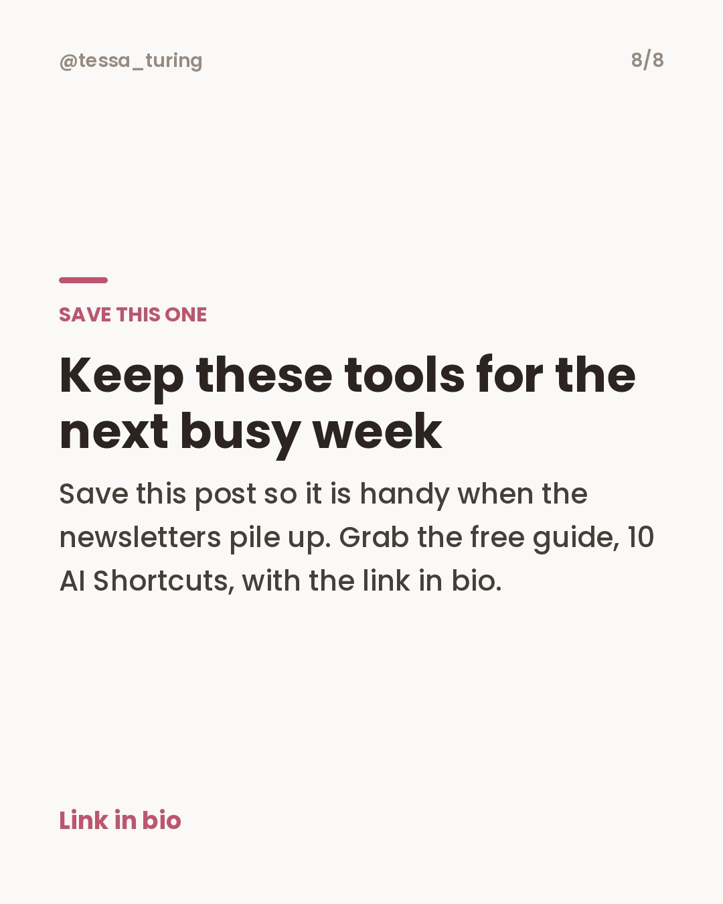

**Scheduled to post Friday, November 20 at 8 AM Eastern.**

To skip it, just **close this issue**. Do nothing and it posts automatically.

**Topic:** AI tools worth trying if you're a stay-at-home parent










**Caption:**

```
5 AI tools that fit the stay-at-home parent day 🧺

Gemini helps with the school emails right in Gmail.
NotebookLM answers questions from the handbook and schedule PDFs you upload.
Canva handles invites and flyers, Khanmigo walks kids through homework, and Perplexity shows its sources.
Slide 7 has a prompt that turns any school newsletter into a dated to-do list.

Check each tool's current pricing and privacy settings before you sign up or upload anything personal.

Save this for the next newsletter pile 📌
The free guide with 10 AI Shortcuts is in my bio.

#stayathomeparent #aitools #momlife #parentinghacks #chatgptprompts
```
