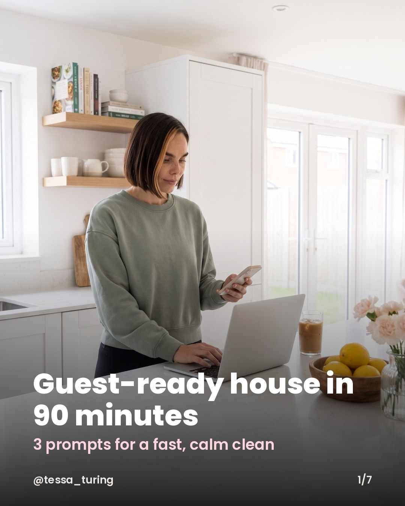
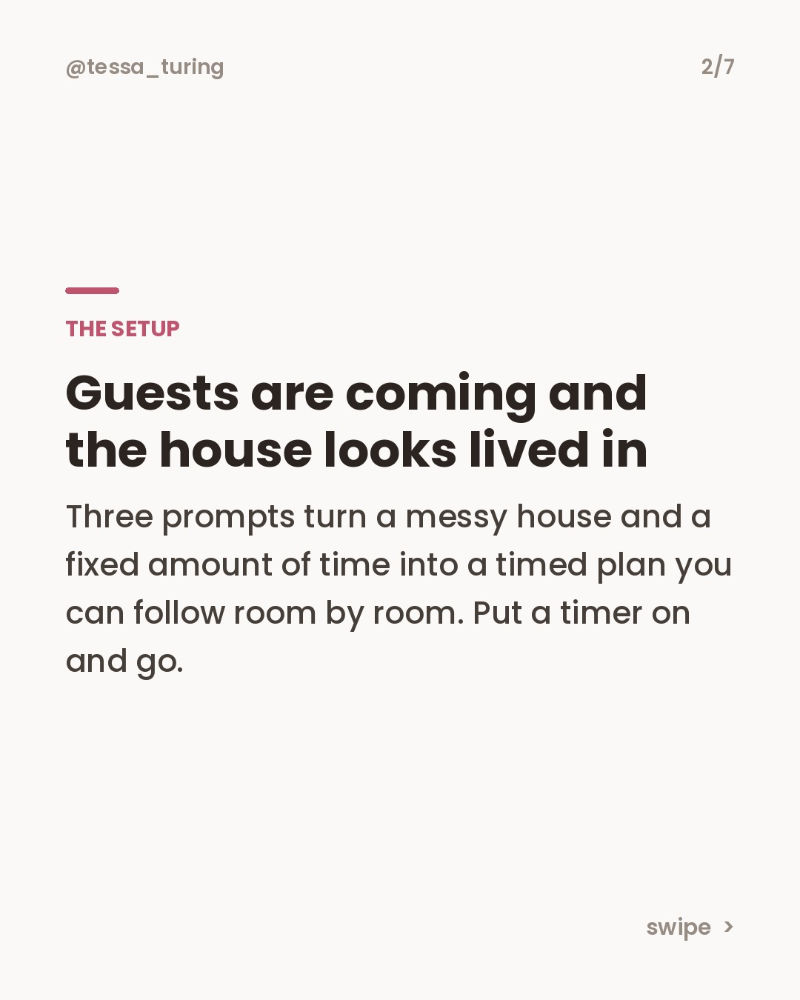
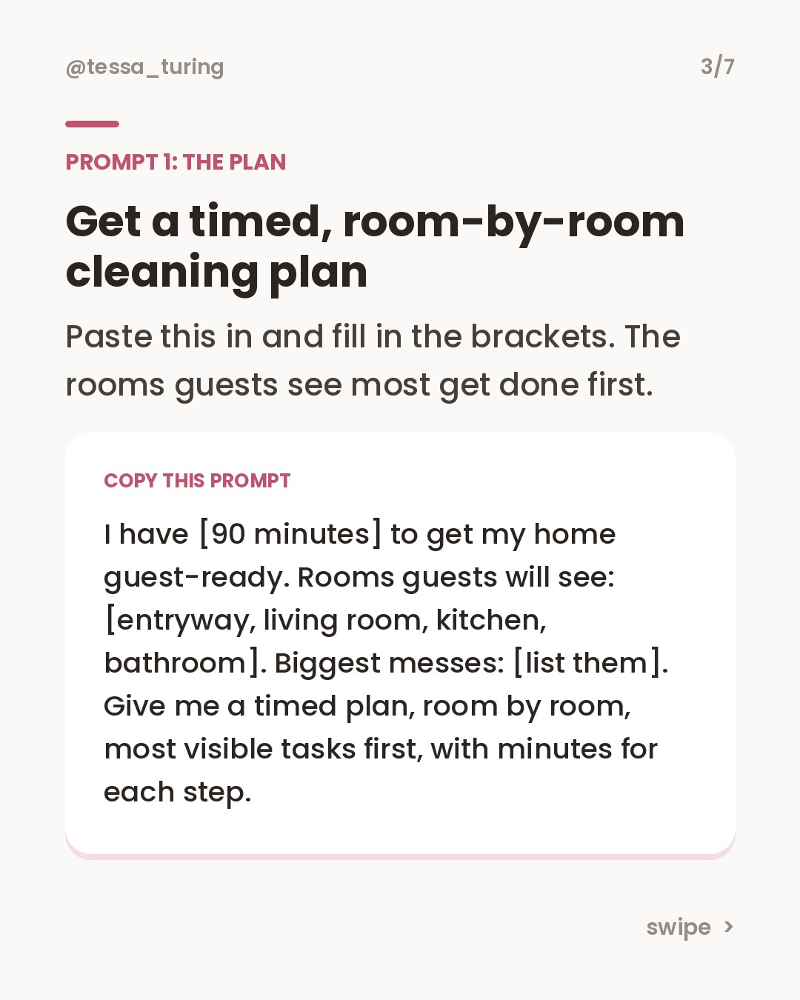
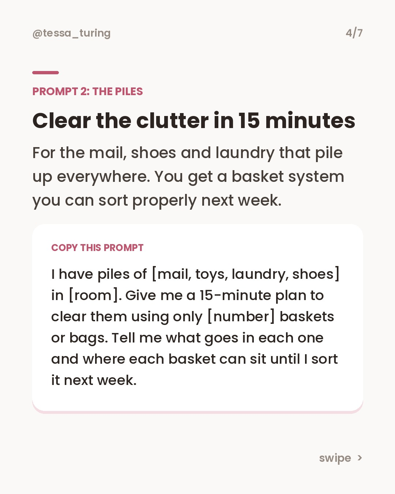
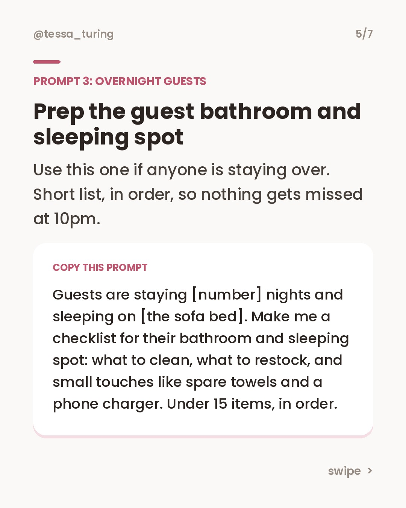
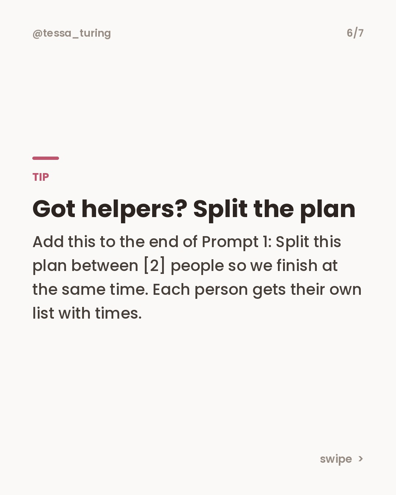

**Scheduled to post Saturday, November 21 at 8 AM Eastern.**

To skip it, just **close this issue**. Do nothing and it posts automatically.

**Topic:** Getting the house guest-ready fast with 3 prompts: a timed room-by-room cleaning plan, a 15-minute clutter clear, and a guest bathroom and sleeping spot checklist









**Caption:**

```
Guests coming soon and the house is a mess? 🧺

These 3 prompts give you a timed cleaning plan for the rooms people actually see.
Prompt 2 clears the piles in 15 minutes with a simple basket system.
Prompt 3 covers the guest bathroom and bed if anyone is staying over.
Works in free ChatGPT, Claude or Gemini.

Save this for the next time someone says they are 20 minutes away.

More shortcuts in my free guide, 10 AI Shortcuts. Link in bio.

#cleaningtips #hostingtips #aiprompts #chatgpttips #homehacks
```
