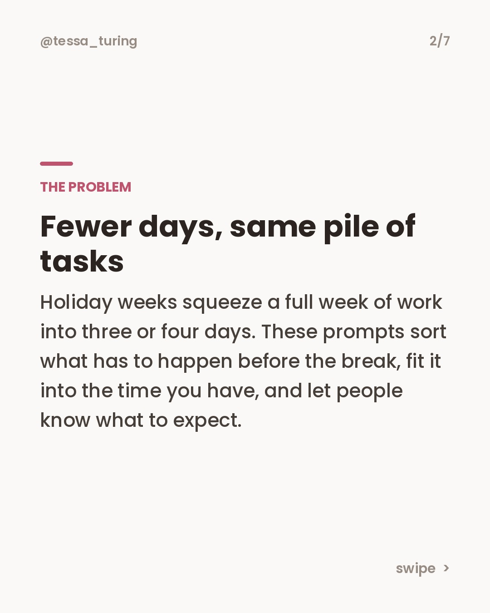
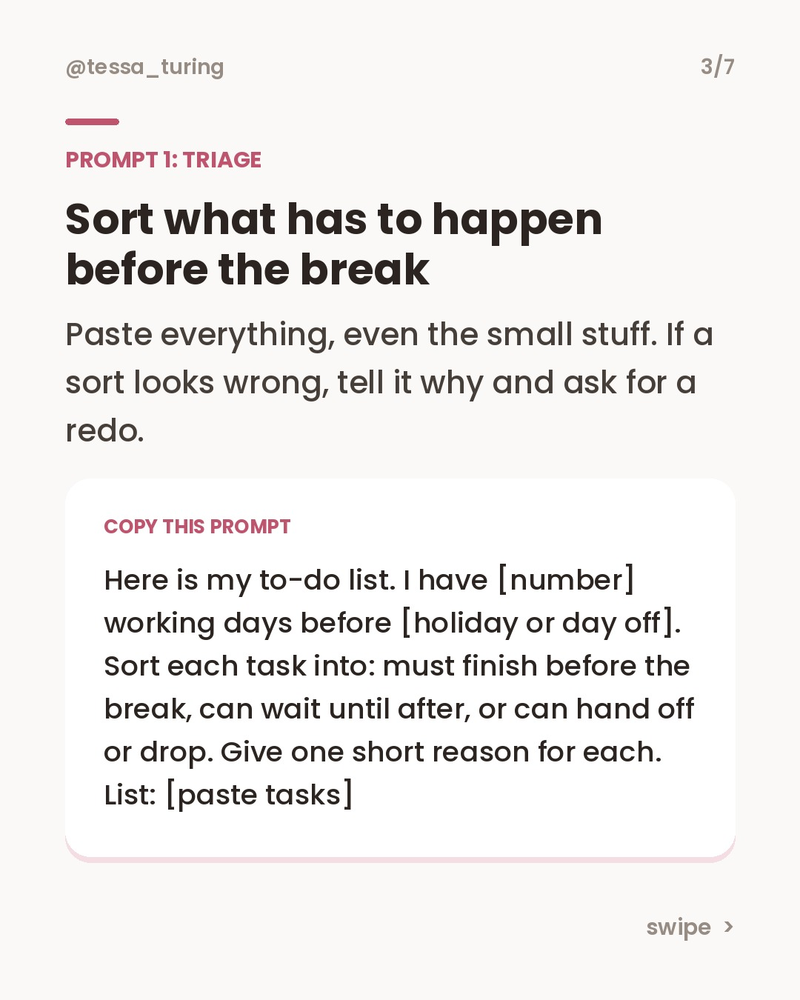
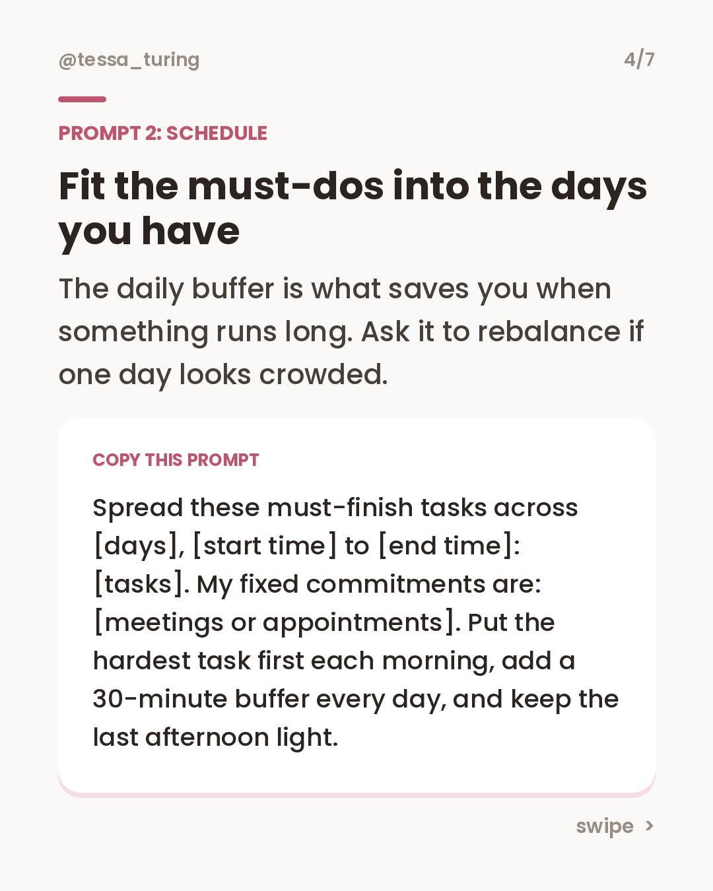
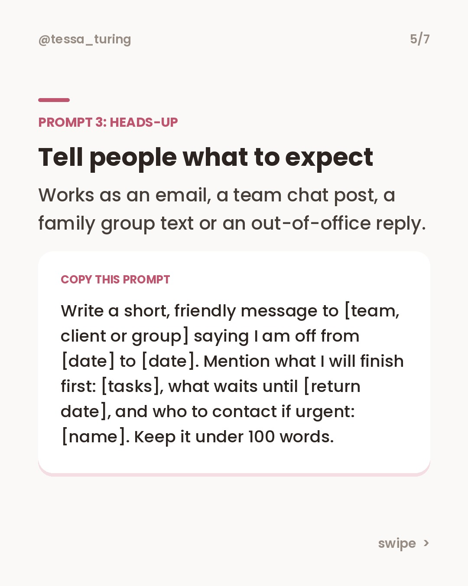
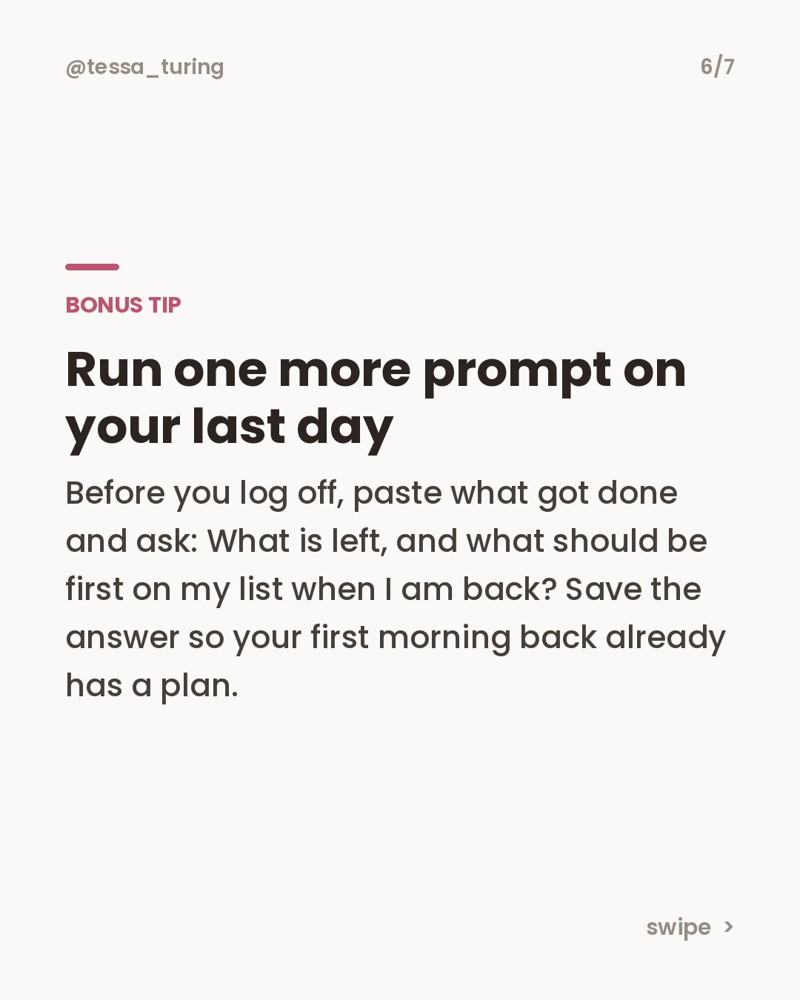
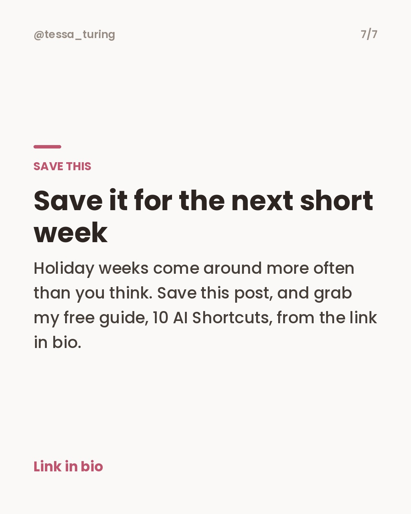

**Scheduled to post Sunday, November 22 at 8 AM Eastern.**

To skip it, just **close this issue**. Do nothing and it posts automatically.

**Topic:** Planning a short holiday week in 3 prompts: triage the to-do list, fit it into the days you have, and send a heads-up message









**Caption:**

```
Holiday week coming up and the to-do list didn't get the memo? 📅

Three prompts to plan it:
1. Triage: what must happen before the break, what can wait, what can go
2. Schedule: fit the must-dos into the days you actually have, with buffers
3. Heads-up: one quick message so nobody is surprised when you're off

Works in ChatGPT, Claude or Gemini, free versions included.

Save this for the next short week 🔖
My free guide, 10 AI Shortcuts, is in the link in bio.

#weeklyreset #aiprompts #holidayplanning #productivitytips #chatgpttips
```
