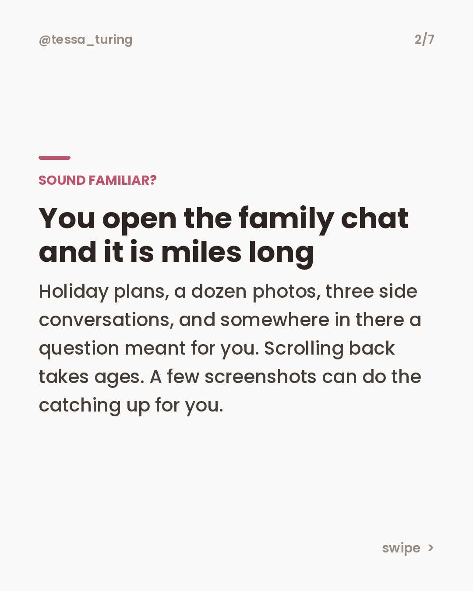
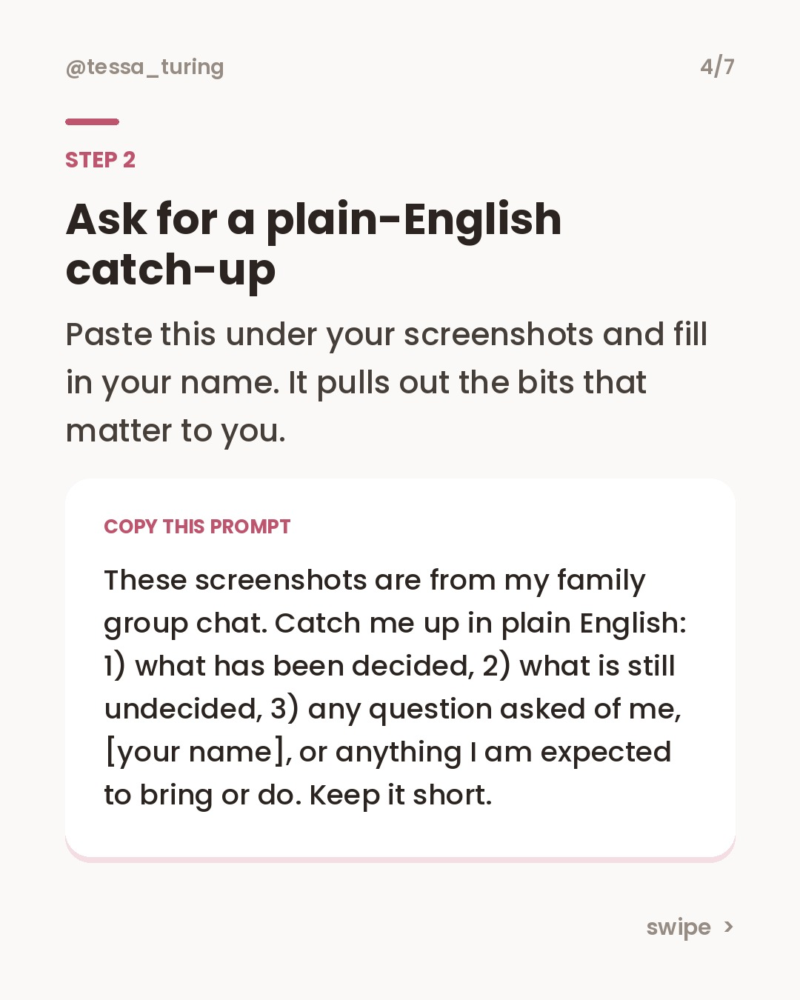
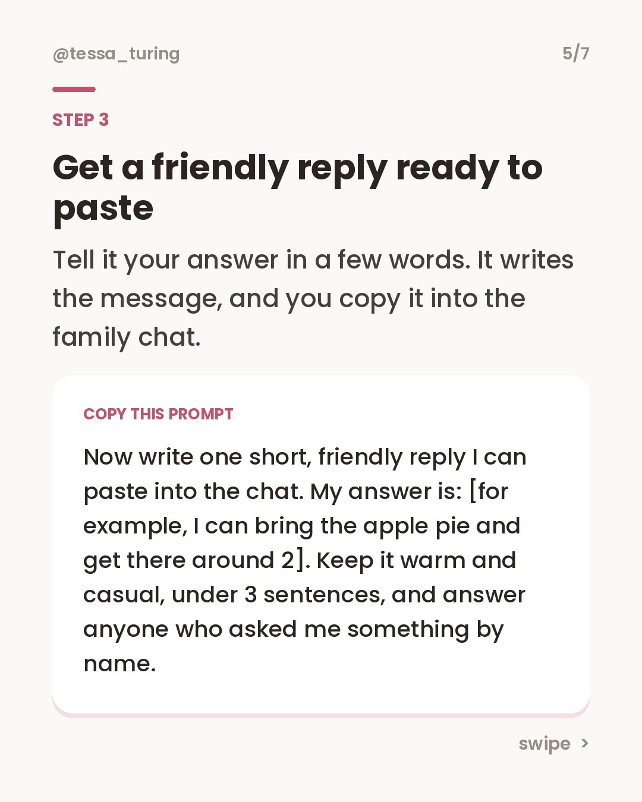
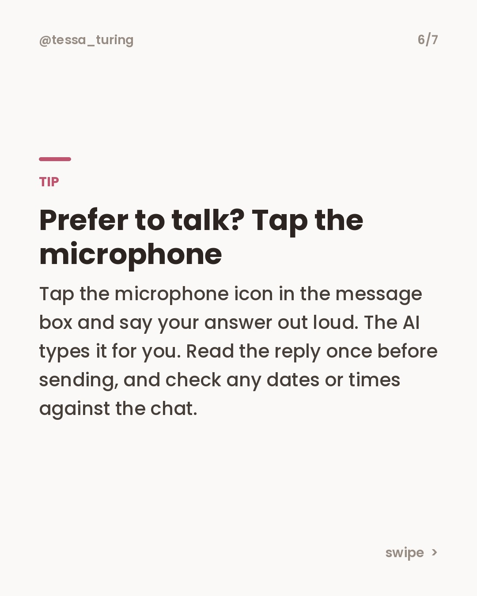
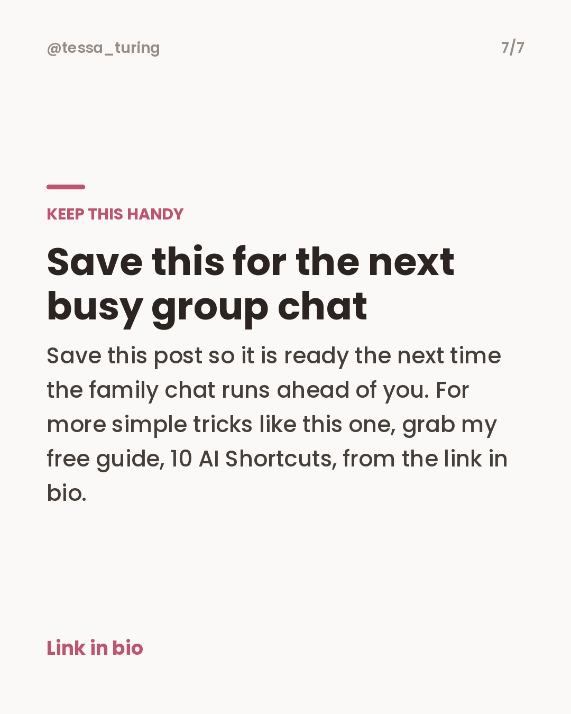

**Scheduled to post Monday, November 23 at 8 AM Eastern.**

To skip it, just **close this issue**. Do nothing and it posts automatically.

**Topic:** Catching up on a busy family group chat by uploading screenshots, getting a plain summary of what you missed, and drafting a friendly reply









**Caption:**

```
Opened the family group chat and found a wall of messages? 📱

Take a few screenshots of what you missed and upload them to ChatGPT, Claude or Gemini.
Ask for a plain-English catch-up: what was decided, what is still open, and anything asked of you.
Then have it draft a short, friendly reply you can paste straight in.
Crop out addresses or account numbers before you upload, and double-check dates and times.

Save this for the next busy week of holiday planning. 💛
My free guide, 10 AI Shortcuts, is waiting for you at the link in bio.

#familygroupchat #aiforbeginners #chatgpttips #stayingintouch #techmadeeasy
```
