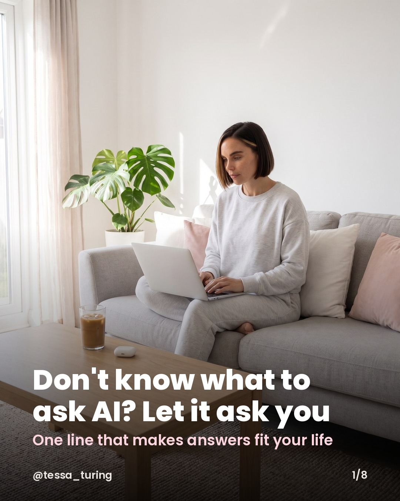
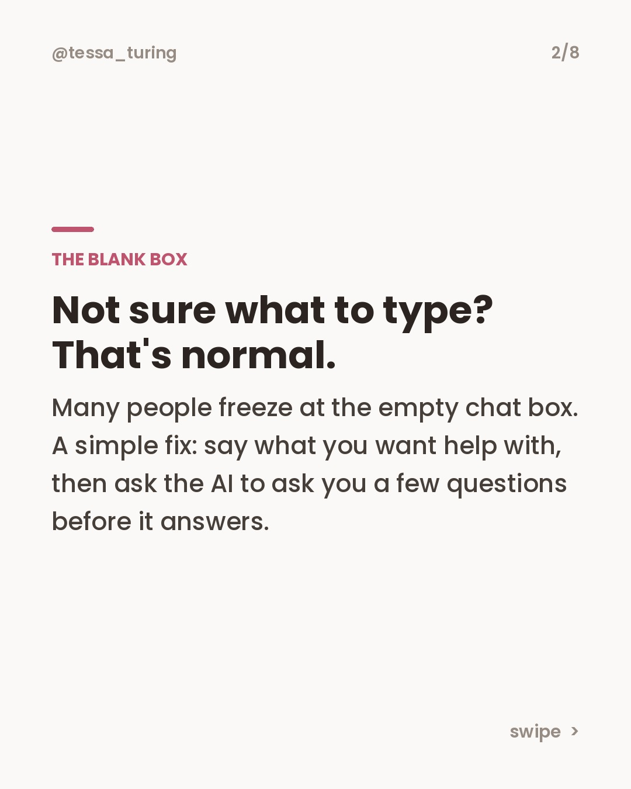
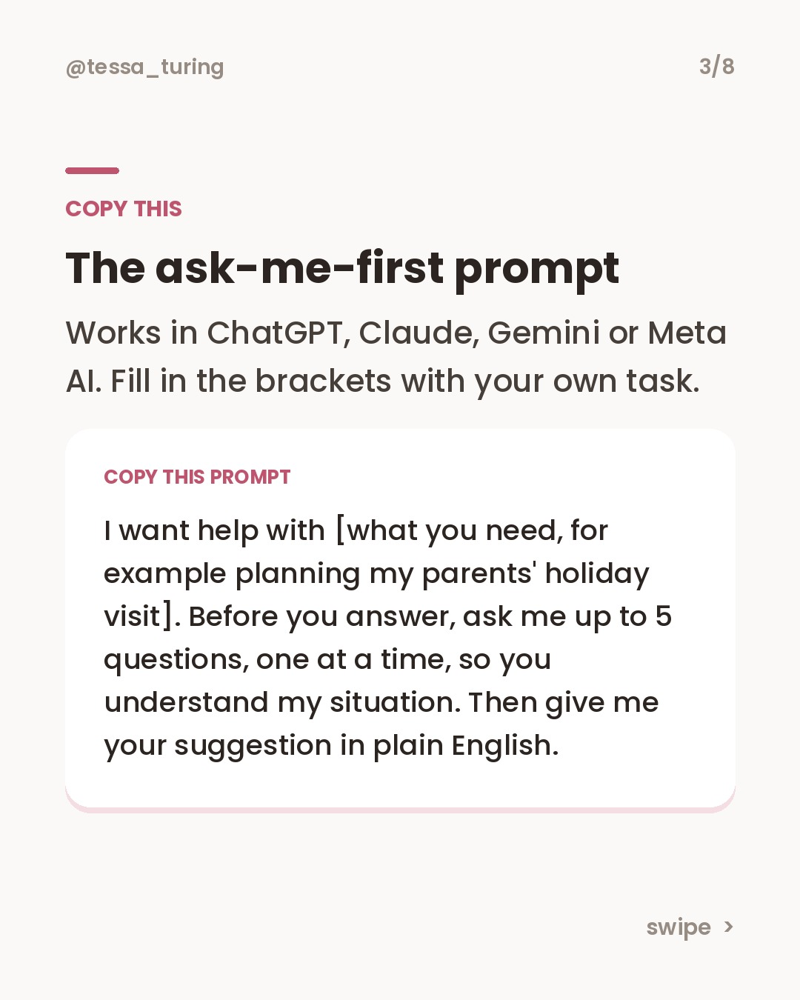
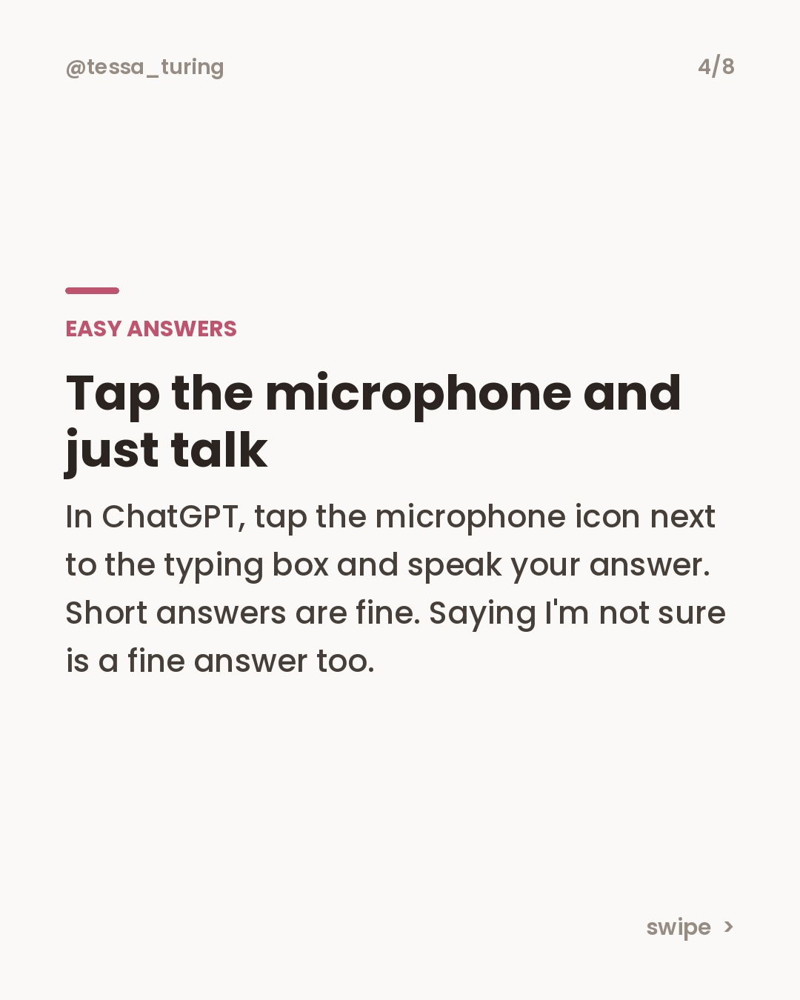
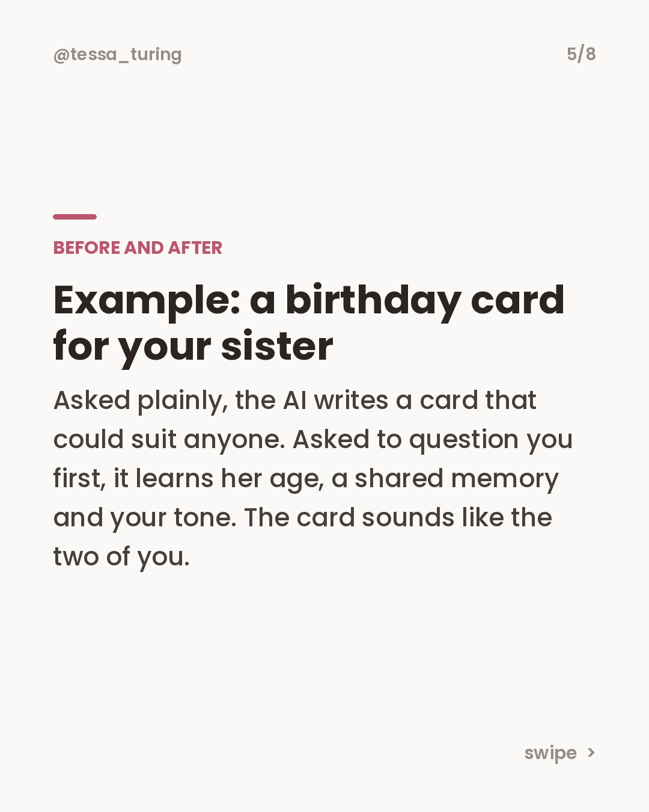
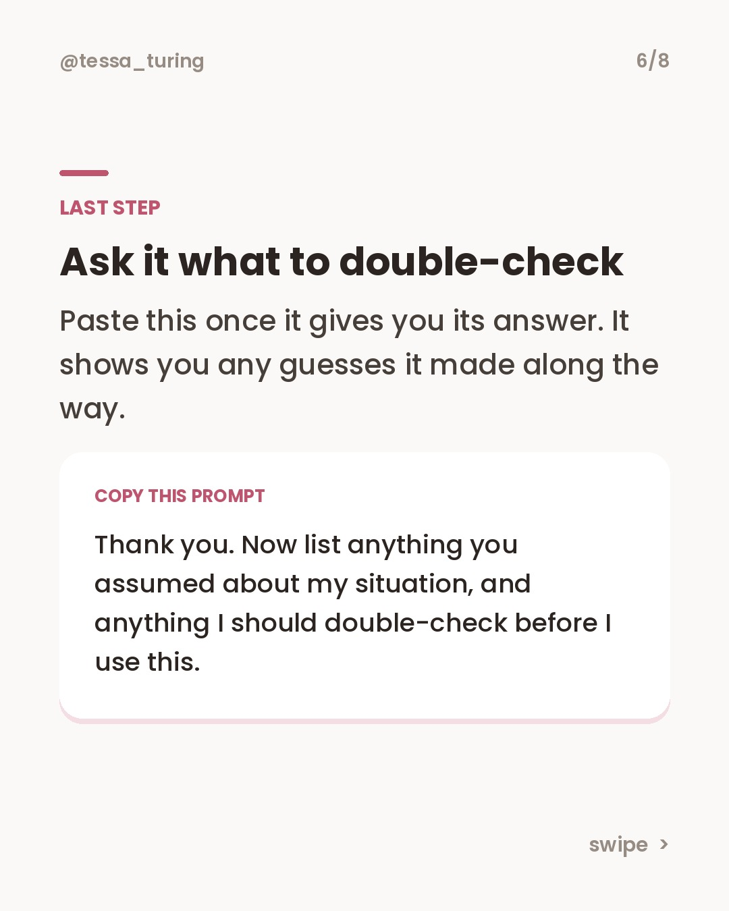
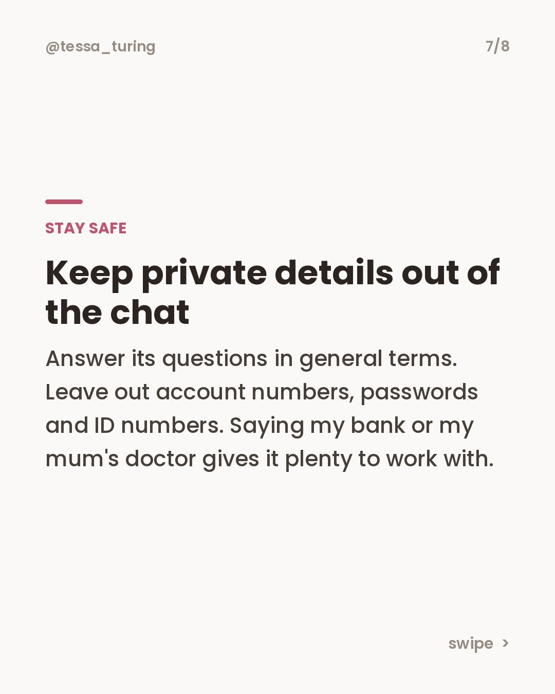
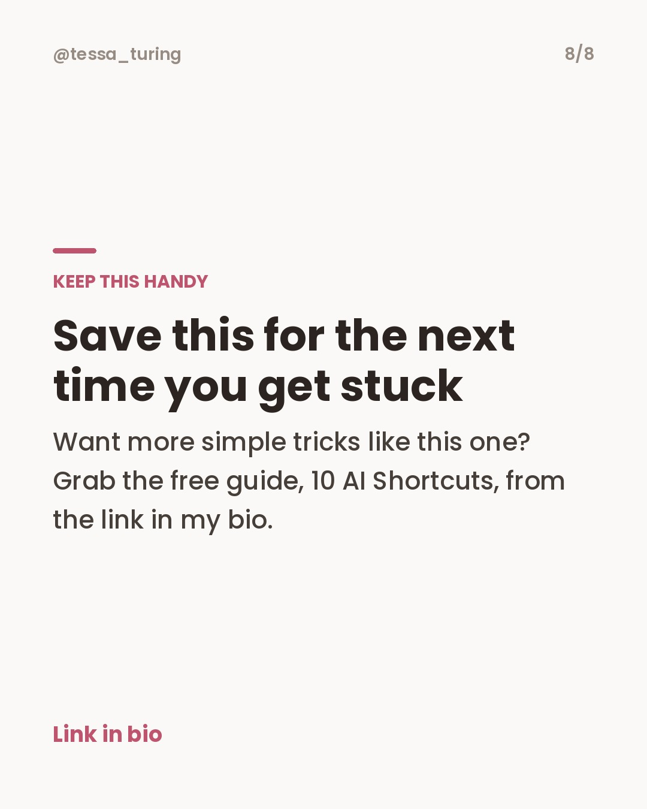

**Scheduled to post Tuesday, November 24 at 8 AM Eastern.**

To skip it, just **close this issue**. Do nothing and it posts automatically.

**Topic:** Getting started: ask the AI to ask you questions first, answer by voice, then have it flag what to double-check










**Caption:**

```
Staring at the AI chat box with no idea what to type? 🤔

Try this: tell it what you need help with, then ask it to ask YOU a few questions first.
It asks one question at a time, and you can tap the microphone and answer out loud.
When it's done, ask it to list what it assumed so you know what to double-check.
As always, keep account numbers, passwords and ID numbers out of the chat. 🔒

Save this post so the prompt is ready when you need it 📌
The free guide, 10 AI Shortcuts, is waiting for you at the link in my bio.

#aiforbeginners #chatgpttips #techhelp #learnsomethingnew #plainenglishai
```
