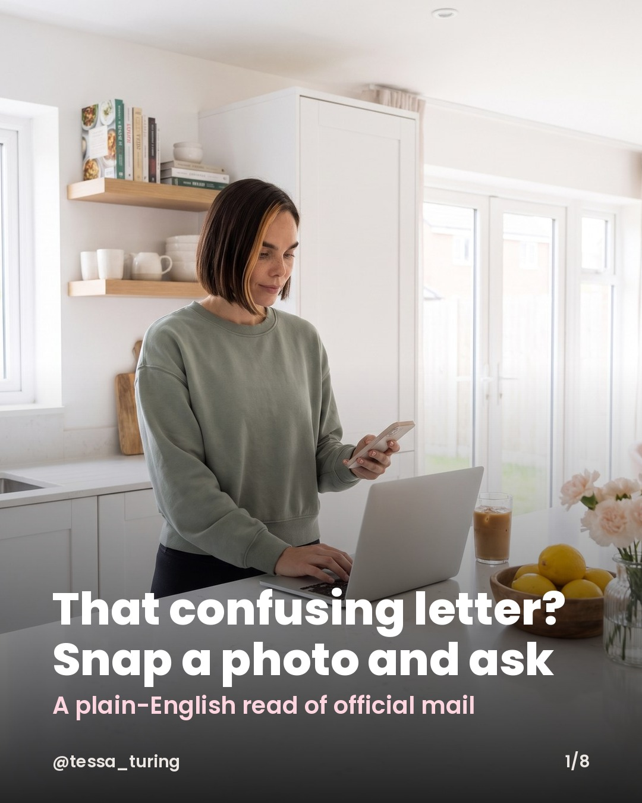
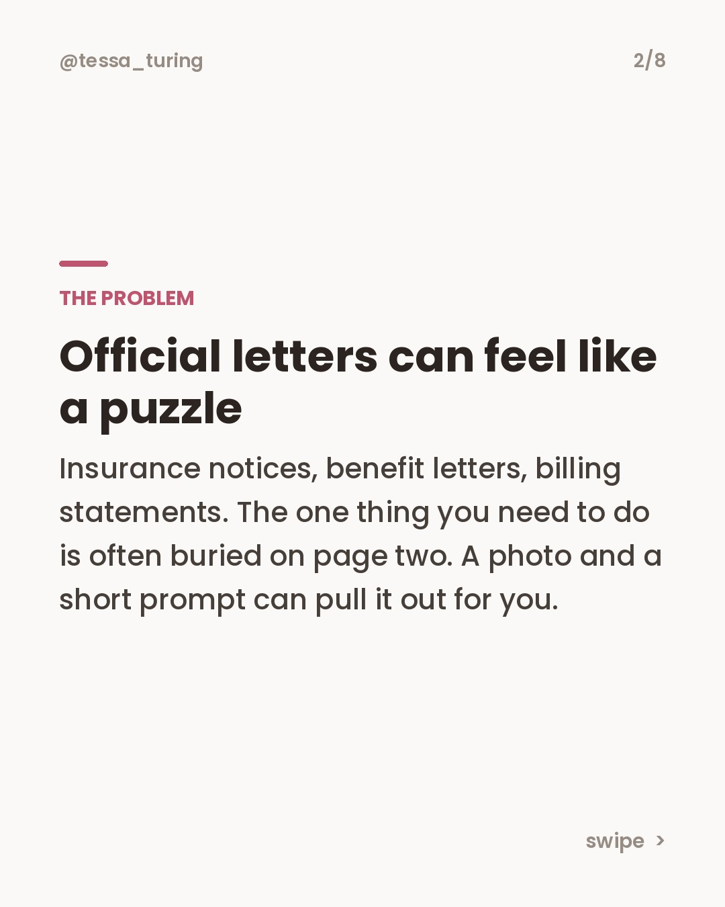
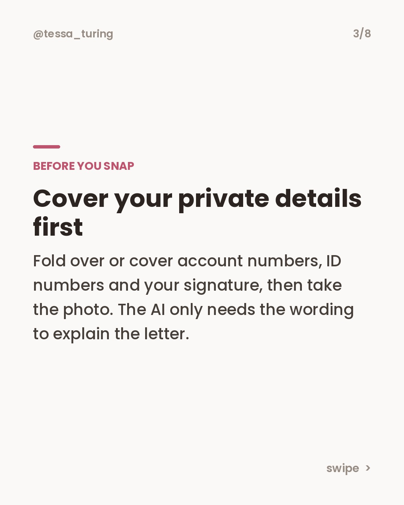
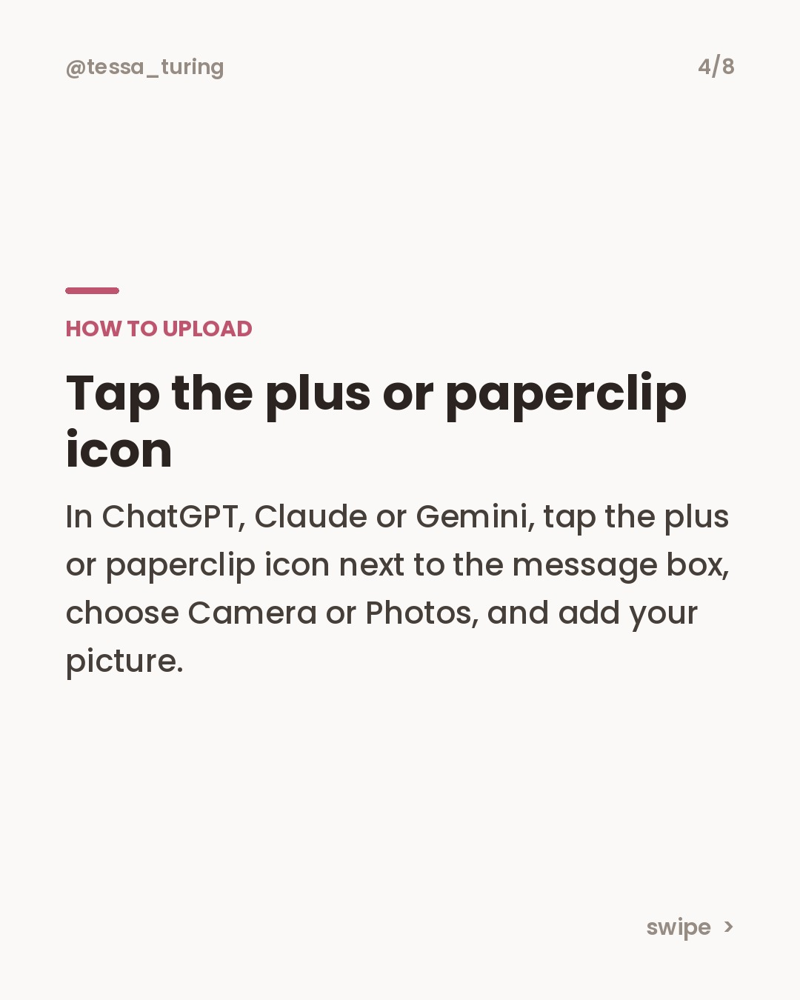
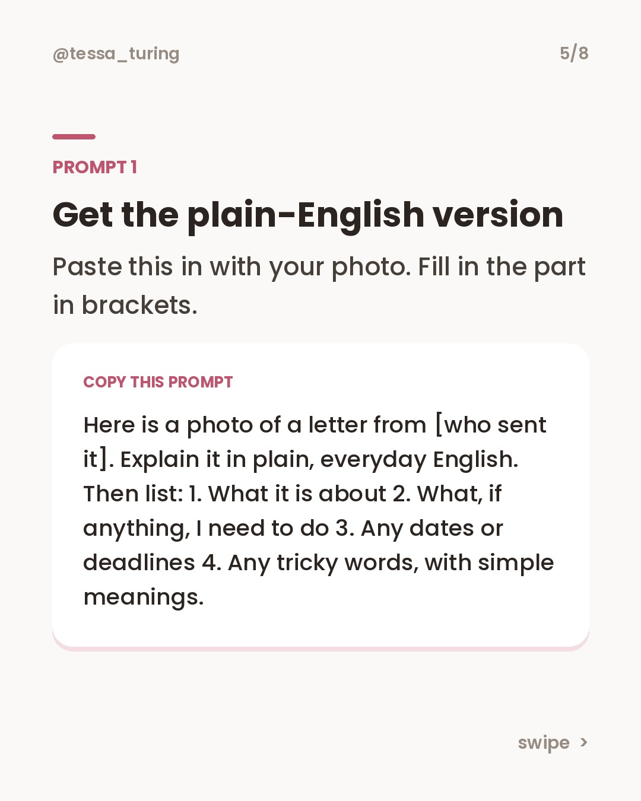
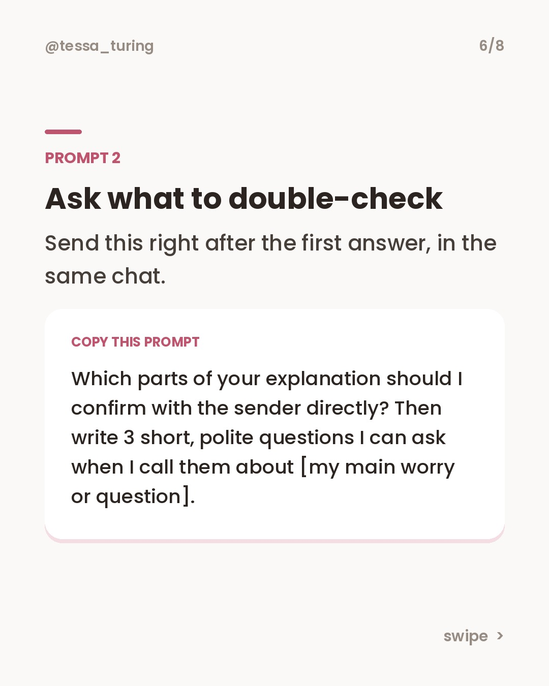
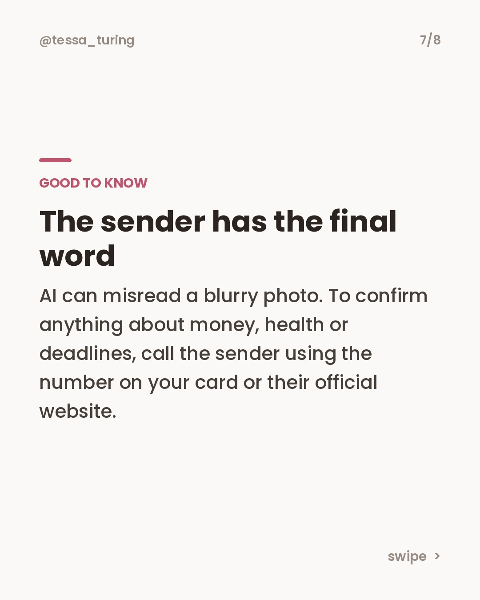
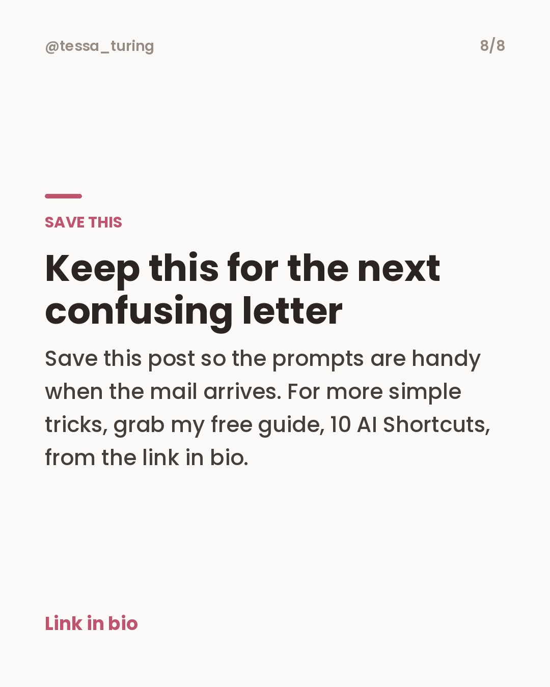

**Scheduled to post Wednesday, November 25 at 8 AM Eastern.**

To skip it, just **close this issue**. Do nothing and it posts automatically.

**Topic:** Photograph a confusing official letter, get a plain-English explanation, and ask the AI what to double-check before calling the sender










**Caption:**

```
That letter you have read three times and still can't quite follow? 📬

Take a photo of it (cover your account and ID numbers first) and upload it to ChatGPT, Claude or Gemini.
Ask for a plain-English summary: what it is about, what you need to do, and any deadlines.
Then ask which parts to confirm, and get a few polite questions ready for your call.
For anything important, call the sender using the number on your card or their official website.

Save this for the next time an official envelope lands on the counter.

My free guide, 10 AI Shortcuts, is waiting for you at the link in bio.
The AI Made Simple 7-day guided workbook is linked there too, if you'd like to practice step by step. 😊

#aiforbeginners #paperworkhelp #plainenglish #chatgpttips #lifeadmin
```
