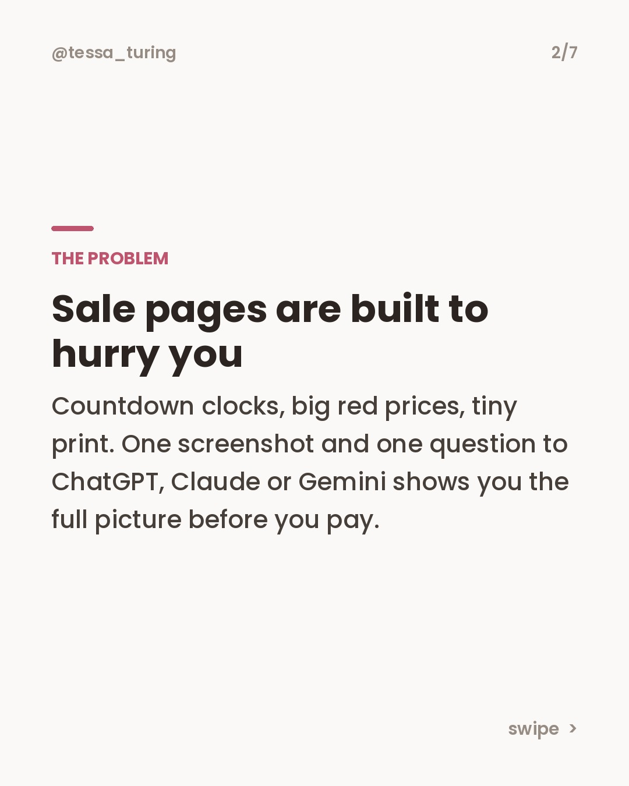
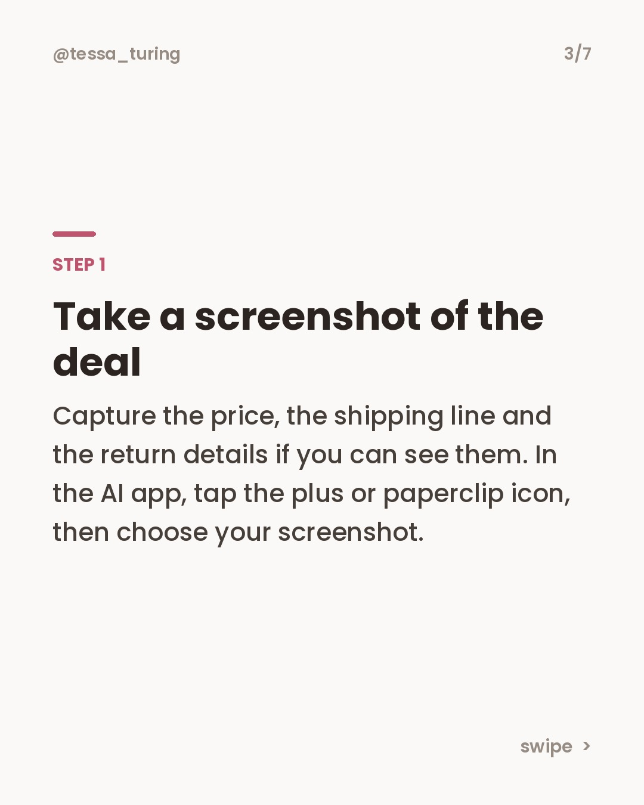
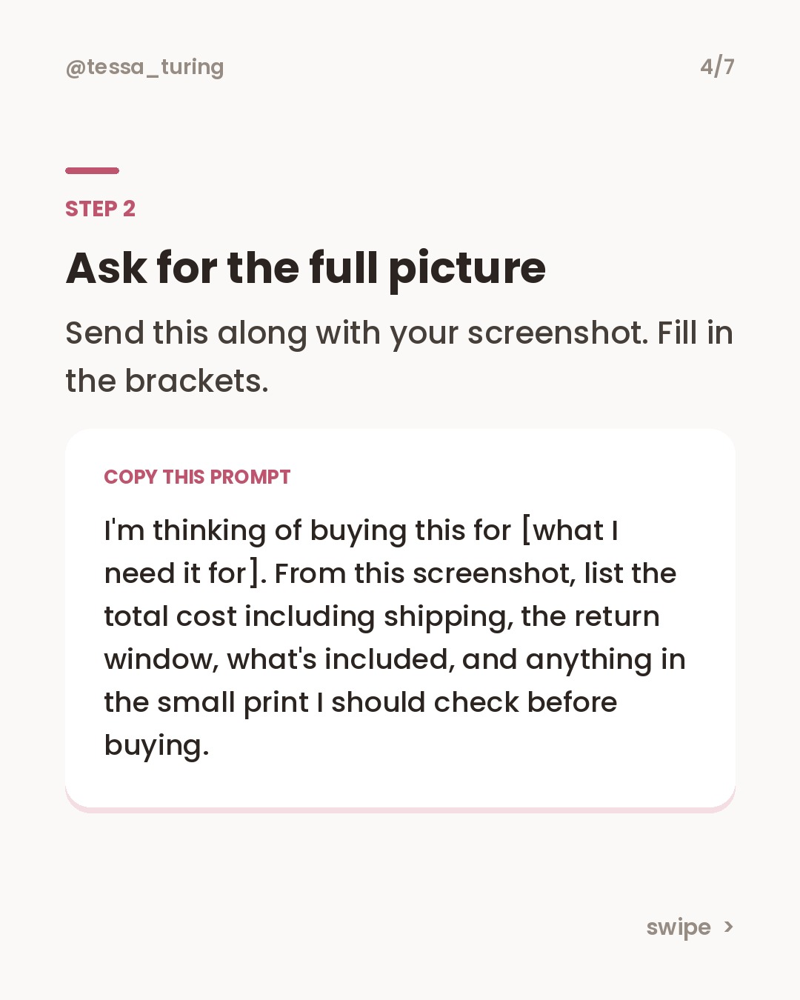
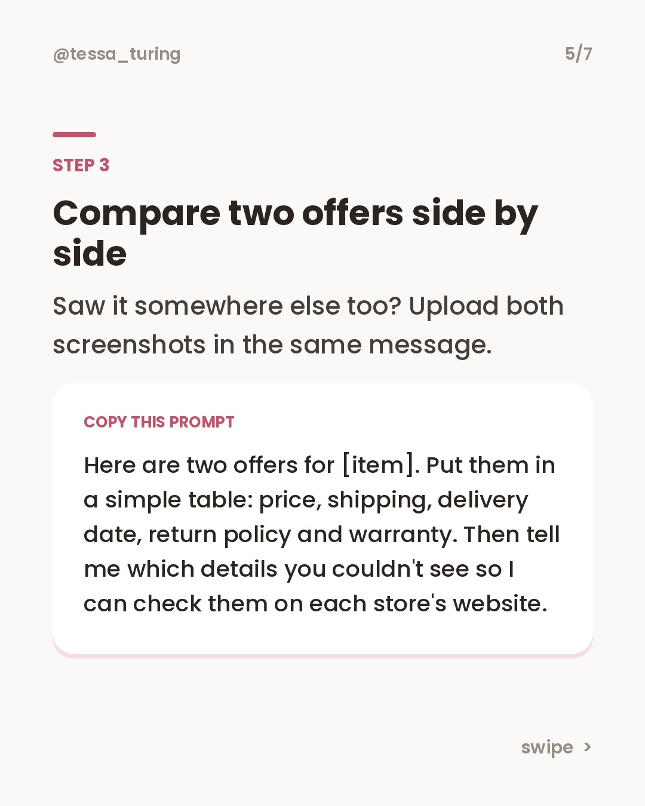
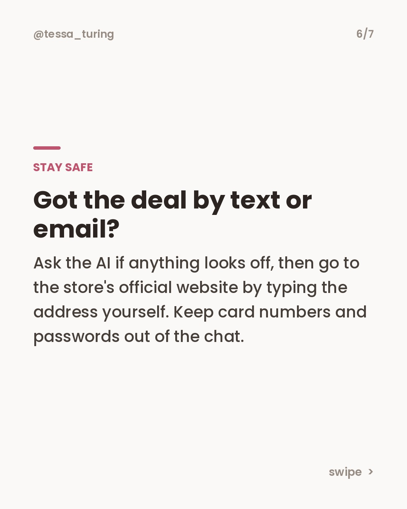
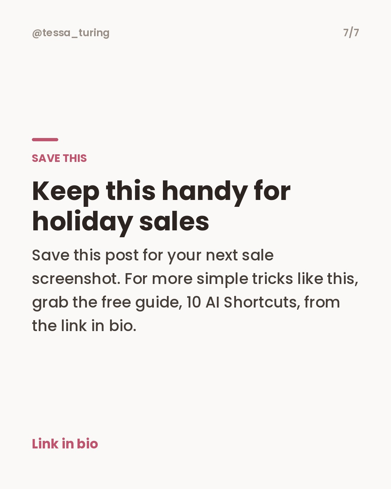

**Scheduled to post Thursday, November 26 at 8 AM Eastern.**

To skip it, just **close this issue**. Do nothing and it posts automatically.

**Topic:** Screenshot an online deal before buying and ask AI for the full cost, return window, small print and a side-by-side comparison









**Caption:**

```
Before you tap Buy this week, try one screenshot 🛒

Take a screenshot of the deal and share it with ChatGPT, Claude or Gemini.
Ask for the total cost with shipping, the return window and the small print.
Found it in two places? Upload both and get a simple side-by-side table.
If the deal came by text or email, check it on the store's official website by typing the address yourself.

Save this for the holiday sales 📌
More easy tricks in my free guide, 10 AI Shortcuts. Link in bio.

#aiforbeginners #holidayshopping #blackfriday #householdadmin #chatgpttips
```
