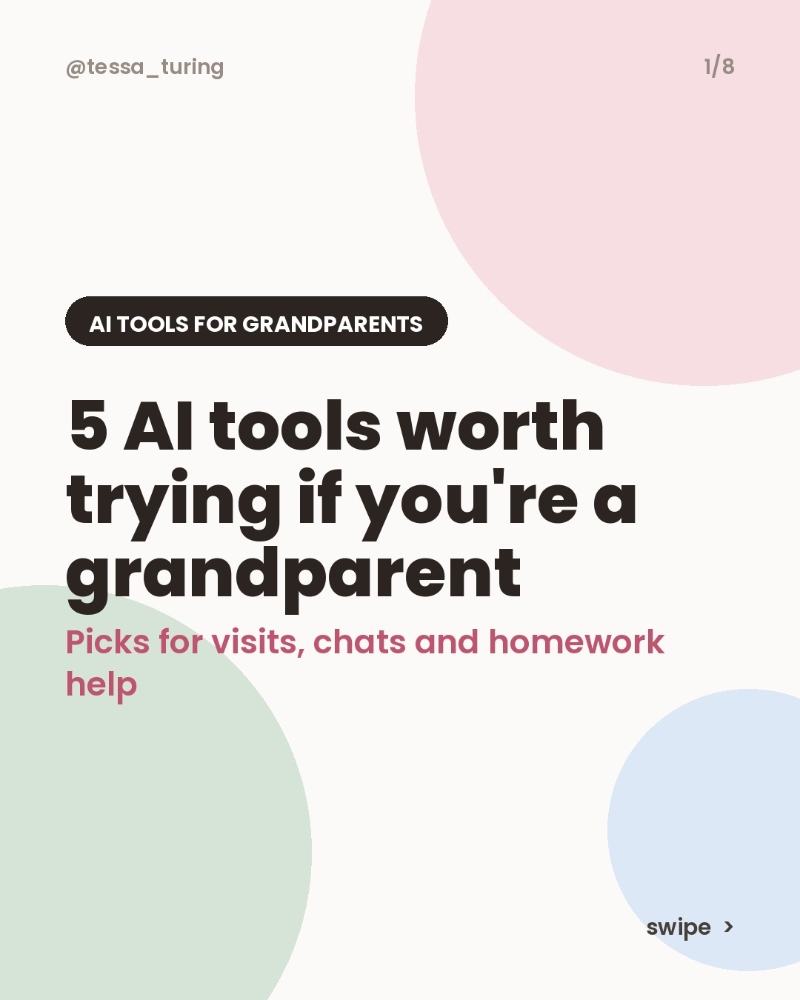
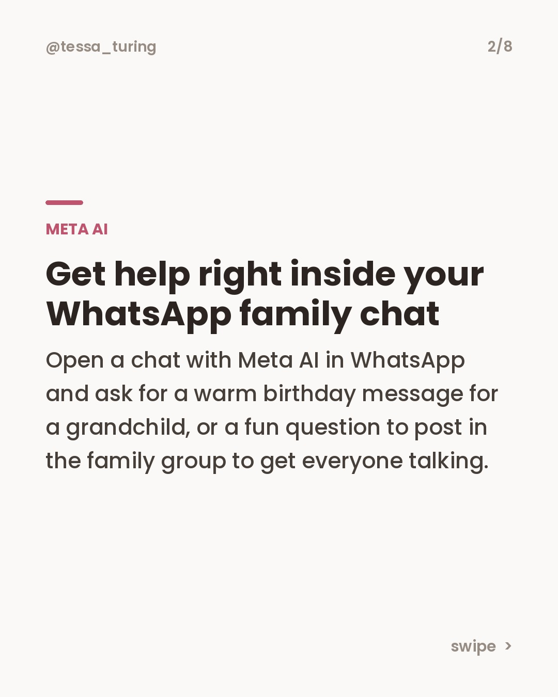
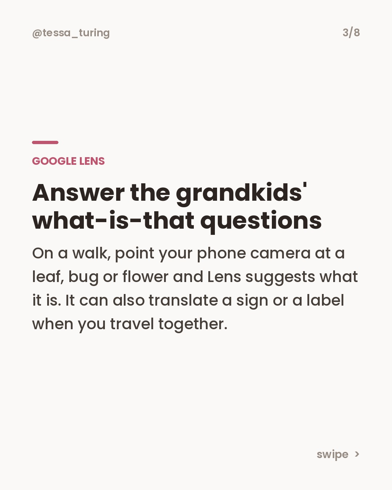
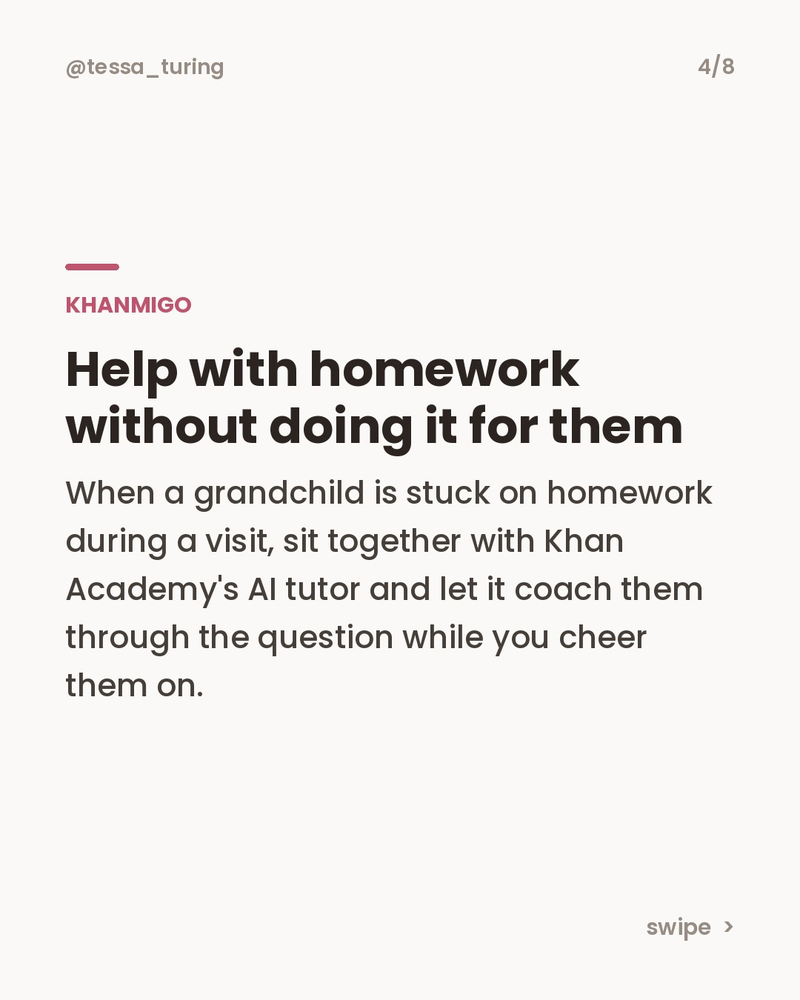
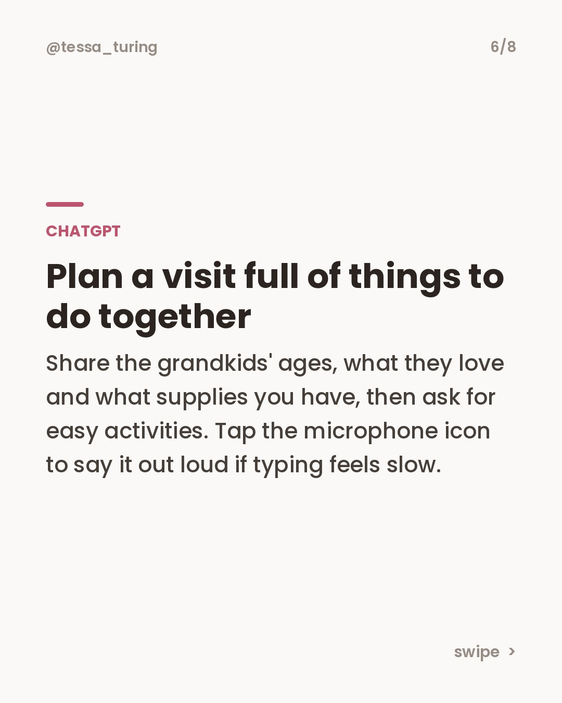
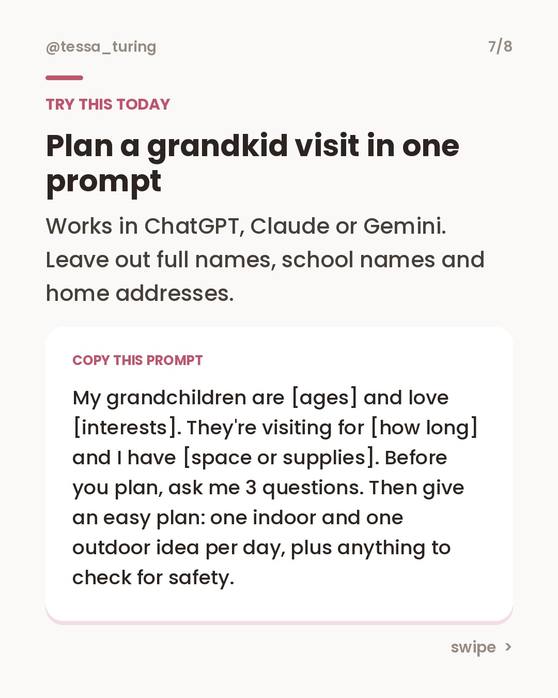
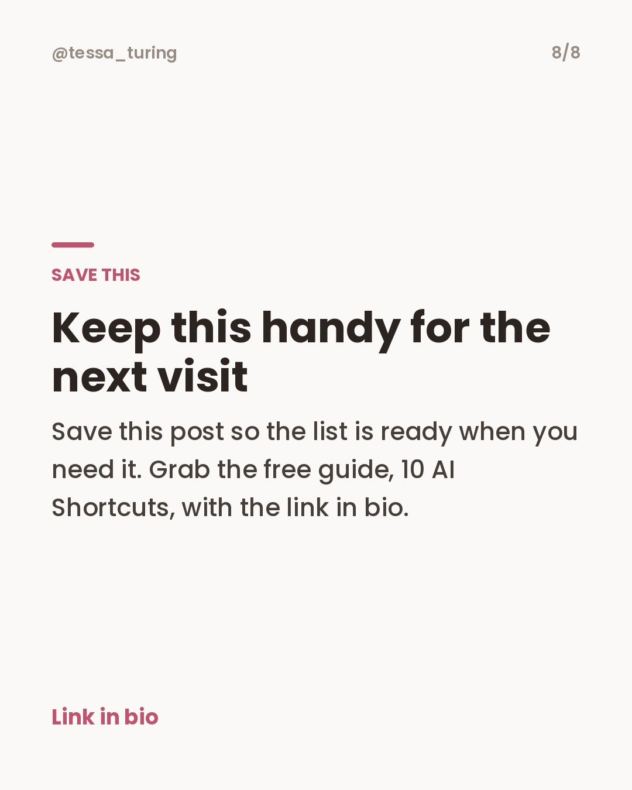

**Scheduled to post Friday, November 27 at 8 AM Eastern.**

To skip it, just **close this issue**. Do nothing and it posts automatically.

**Topic:** AI tools worth trying if you're one of the grandparents










**Caption:**

```
Five AI tools that fit right into grandparent life 👵👴

Meta AI lives inside WhatsApp, so help is one chat away.
Google Lens answers the endless what-is-that questions on walks.
Khanmigo, Canva and ChatGPT cover homework help, party flyers and visit plans.
Before you sign up, check each tool's current pricing and privacy settings.

Save this for the next time the grandkids come over 📌
The free guide, 10 AI Shortcuts, is waiting in my bio.
If you'd like to practice step by step, the AI Made Simple 7-day guided workbook is linked there too.

#grandparents #aiforbeginners #grandparentlife #techtips #aitools
```
