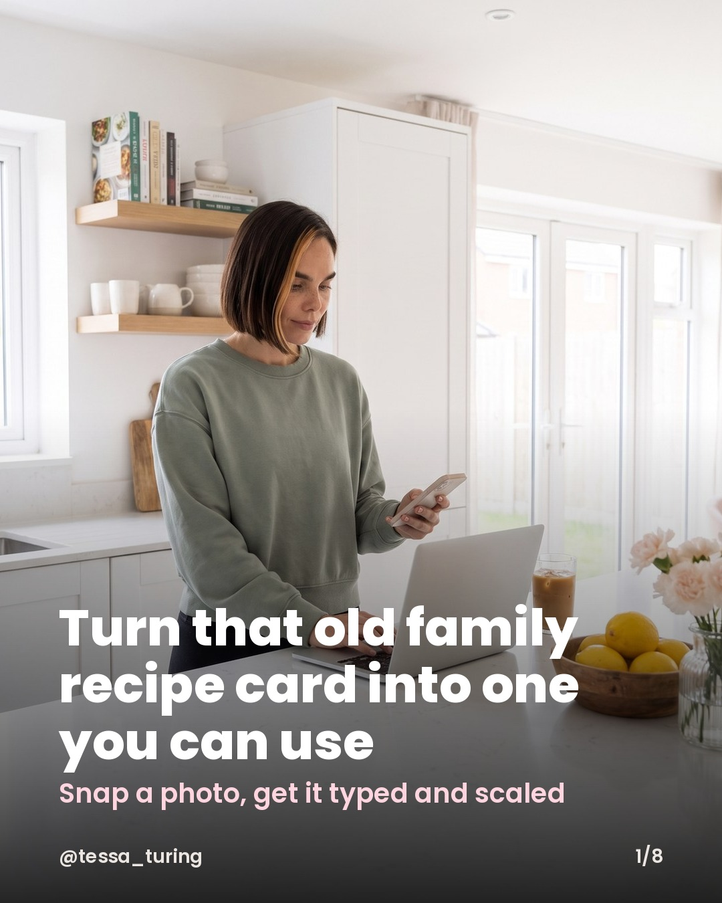
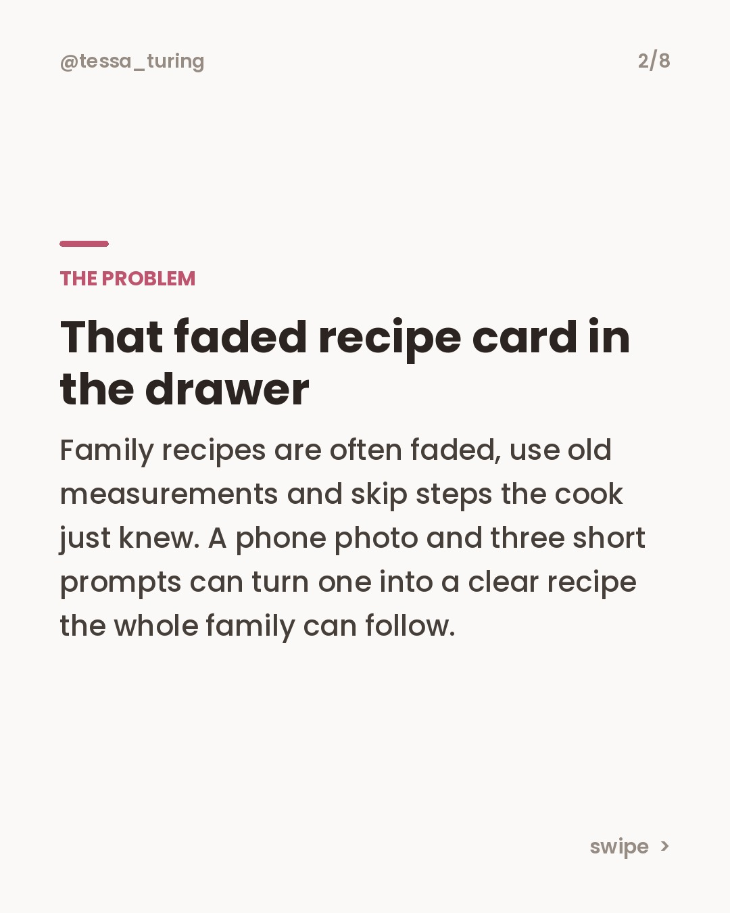
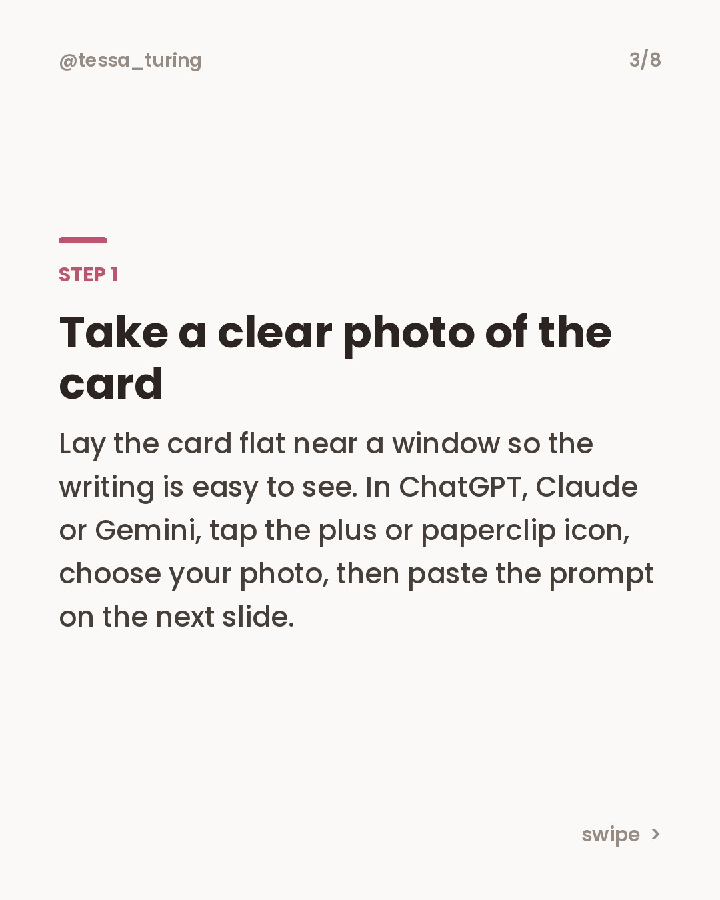
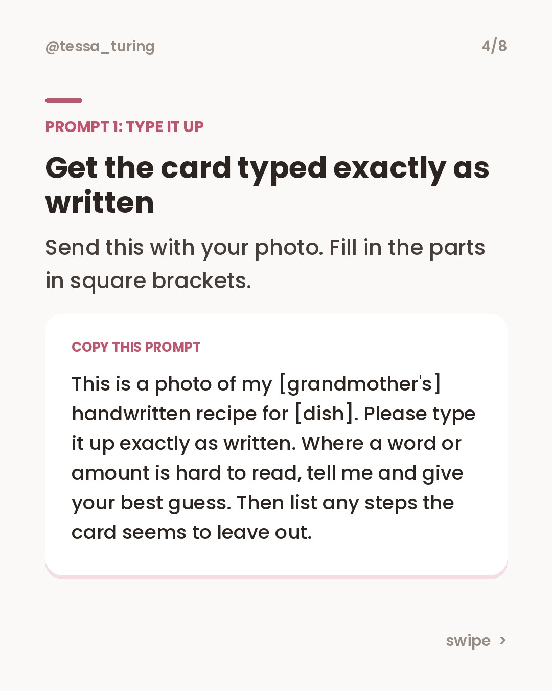
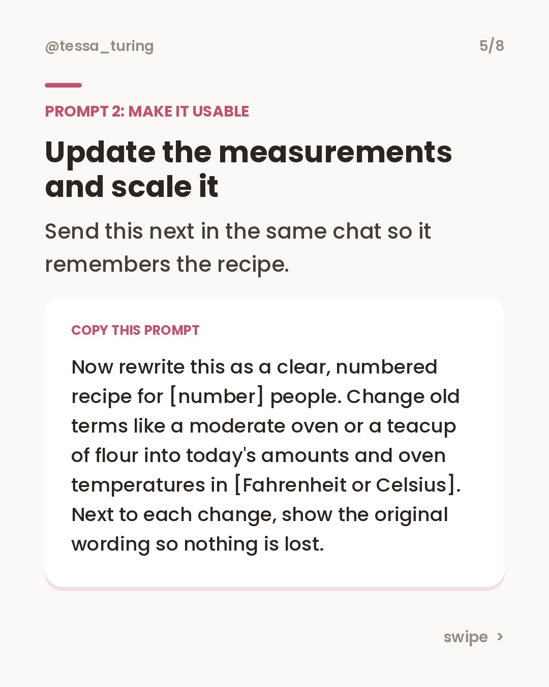
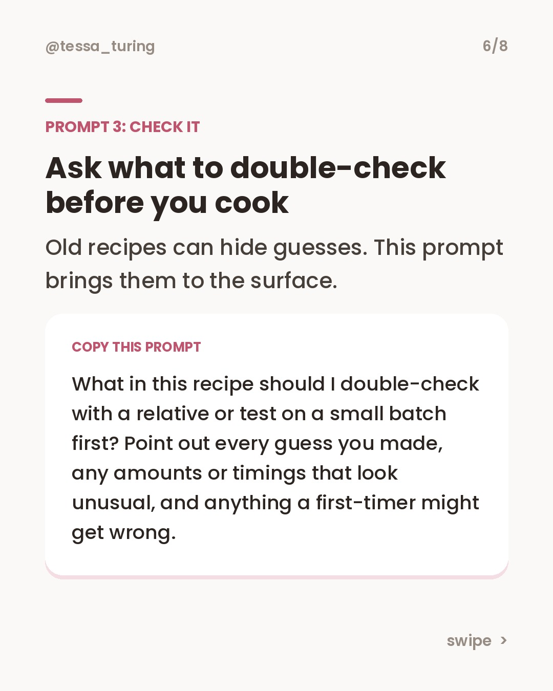
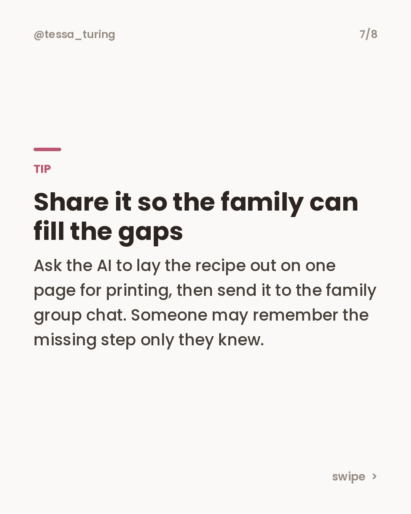
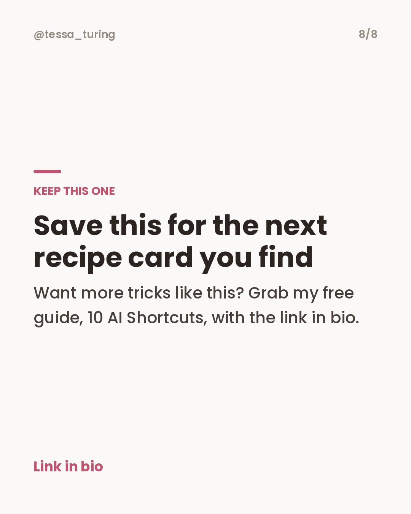

**Scheduled to post Saturday, November 28 at 8 AM Eastern.**

To skip it, just **close this issue**. Do nothing and it posts automatically.

**Topic:** Photograph a handwritten family recipe card, have AI type it up, modernize and scale it, then flag what to double-check










**Caption:**

```
That handwritten recipe card everyone loves can become a clear, printable recipe in a few minutes 📸🥧

Take a photo of the card and upload it to ChatGPT, Claude or Gemini.
Ask it to type the card up exactly, then update old measurements and scale it for your crowd.
Last step: ask what to double-check, so you know which guesses to confirm with family or test first.

Save this for the next time you find an old recipe card in the drawer 🔖
For more simple tricks, my free guide 10 AI Shortcuts is waiting at the link in bio.

#familyrecipes #aiforbeginners #chatgpttips #grandparentlife #holidaybaking
```
